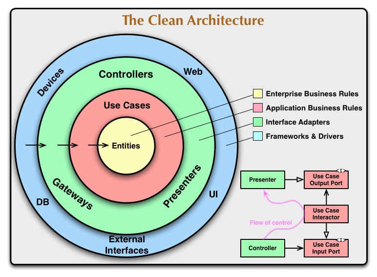

# The Clean Architecture

## Tổng quan

Một hệ thống được tổ chức theo Clean Architecture hướng tới các đặc tính sau:

- **Độc lập với framework:** framework chỉ là công cụ, không quyết định cấu trúc của toàn bộ ứng dụng.
- **Dễ kiểm thử:** có thể kiểm thử business rules mà không cần UI, database, web server hoặc thành phần bên ngoài.
- **Độc lập với UI:** có thể thay Web UI bằng CLI hay một giao diện khác mà không sửa quy tắc nghiệp vụ.
- **Độc lập với database:** có thể thay Oracle, SQL Server hoặc MongoDB bằng công nghệ khác mà không làm thay đổi business rules.
- **Độc lập với tác nhân bên ngoài:** phần lõi nghiệp vụ không cần biết chi tiết về thế giới bên ngoài.

**Ví dụ xuyên suốt:** một cửa hàng có chức năng **hủy đơn hàng**. Quy tắc là chỉ đơn đang `pending` mới được hủy; đơn đã `shipped` thì không. Người dùng có thể gửi yêu cầu từ website, ứng dụng điện thoại hoặc command line, nhưng quy tắc này phải được dùng chung và không phụ thuộc vào giao diện hay database.

## Sơ đồ Clean Architecture



*Các vòng của Clean Architecture và ví dụ đảo chiều dependency tại Use Case Boundary. Nguồn: Robert C. Martin.*

Các vòng tròn đại diện cho những khu vực có trách nhiệm khác nhau trong phần mềm. Càng đi vào trong, code càng trừu tượng, ổn định và chứa các chính sách cấp cao. Càng đi ra ngoài, code càng cụ thể và liên quan nhiều hơn đến cơ chế triển khai.

## Dependency Rule

Quy tắc quan trọng nhất của Clean Architecture là:

> Dependency trong source code chỉ được hướng vào trong.

Điều đó có nghĩa là:

- Tầng ngoài có thể biết và phụ thuộc vào tầng trong.
- Tầng trong không được biết bất kỳ thành phần nào thuộc tầng ngoài.
- Tên class, function, biến hoặc kiểu dữ liệu được khai báo ở tầng ngoài không được xuất hiện trong code của tầng trong.
- Dữ liệu do framework hoặc database tạo ra không được truyền trực tiếp vào phần lõi.

Mục đích là ngăn thay đổi ở UI, database, framework hoặc dịch vụ bên ngoài tác động đến các quy tắc nghiệp vụ quan trọng.

**Ví dụ:** entity `Order` có hàm `cancel()` và không import Django, không chạy câu SQL, cũng không trả HTTP status. Django view và repository được phép phụ thuộc vào code hủy đơn, nhưng `Order` không được phụ thuộc ngược lại vào chúng. Vì vậy, việc đổi Django sang framework khác hoặc PostgreSQL sang MongoDB không làm thay đổi quy tắc hủy đơn.

## Các tầng chính

### 1. Entities

Entities đóng gói các quy tắc nghiệp vụ tổng quát và quan trọng nhất của tổ chức hoặc ứng dụng. Entity có thể là object chứa dữ liệu và phương thức, hoặc tập hợp cấu trúc dữ liệu và các hàm xử lý.

Đây là tầng ổn định nhất. Những thay đổi về điều hướng trang, bảo mật, UI, database hoặc framework không nên làm thay đổi Entity.

**Ví dụ ngắn:**

```python
class Order:
    def __init__(self, status):
        self.status = status

    def cancel(self):
        if self.status != "pending":
            raise ValueError("Chỉ đơn đang chờ mới được hủy")
        self.status = "cancelled"
```

`Order` chỉ bảo vệ quy tắc chuyển trạng thái. Nó không biết đơn được lưu ở đâu hoặc yêu cầu hủy đến từ giao diện nào.

### 2. Use Cases

Use Cases chứa các quy tắc nghiệp vụ dành riêng cho ứng dụng và triển khai những trường hợp sử dụng của hệ thống. Use Case điều phối dữ liệu đến và đi từ Entity, yêu cầu Entity áp dụng quy tắc nghiệp vụ và hoàn thành một mục tiêu cụ thể.

Thay đổi database, UI hoặc framework không nên ảnh hưởng đến Use Case. Tuy nhiên, khi quy trình nghiệp vụ của ứng dụng thay đổi thì code trong tầng này có thể phải thay đổi.

**Ví dụ ngắn:** use case `CancelOrder` nhận `order_id`, lấy đơn qua repository, gọi `order.cancel()` rồi lưu lại:

```python
class CancelOrder:
    def __init__(self, orders):
        self.orders = orders

    def execute(self, order_id):
        order = self.orders.get(order_id)
        order.cancel()
        self.orders.save(order)
```

Use Case biết mục tiêu “hủy đơn”, nhưng không biết repository đang dùng SQL, MongoDB hay dữ liệu giả trong unit test.

### 3. Interface Adapters

Interface Adapters chuyển đổi dữ liệu giữa dạng thuận tiện cho Use Case và Entity với dạng cần thiết cho database, web, UI hoặc dịch vụ bên ngoài.

Controller, Presenter, View và các thành phần MVC thường nằm trong tầng này. SQL và logic ánh xạ dữ liệu persistence cũng nên được giới hạn tại đây để phần lõi không cần biết database hoạt động như thế nào.

**Ví dụ:**

- Controller đọc `order_id` từ HTTP request rồi gọi `CancelOrder.execute(order_id)`.
- Repository chuyển một bản ghi ORM thành `Order` và lưu trạng thái mới trở lại database.
- Presenter chuyển kết quả thành JSON như `{"id": 10, "status": "cancelled"}`.

Các adapter làm nhiệm vụ chuyển đổi định dạng; chúng không quyết định đơn hàng có được phép hủy hay không.

### 4. Frameworks and Drivers

Đây là tầng ngoài cùng, chứa web framework, database, UI, thiết bị, SDK, dịch vụ bên ngoài và mã kết nối chúng với tầng bên trong.


**Ví dụ:** Django/Flask nhận request, PostgreSQL lưu đơn và một SDK gửi email xác nhận. Có thể thay PostgreSQL bằng MongoDB hoặc thay REST API bằng CLI, còn `Order.cancel()` và `CancelOrder` vẫn giữ nguyên.

## Có bắt buộc phải có đúng bốn tầng không?

Không. Bốn tầng chỉ là hướng dẫn, có thể tăng hoặc giảm tùy độ phức tạp của ứng dụng. Điều quan trọng là business logic không phụ thuộc vào UI, framework và database.

**Ví dụ:** chức năng hủy đơn nhỏ có thể tổ chức thành ba layer:

1. **Domain Layer:** `Order` chứa quy tắc chỉ đơn `pending` mới được hủy.
2. **Application Layer:** `CancelOrder` điều phối quy trình lấy đơn, hủy và lưu lại.
3. **Infrastructure Layer:** HTTP Controller nhận request; Repository đọc và ghi database.

```text
Infrastructure Layer → Application Layer → Domain Layer
Controller/Repository    CancelOrder         Order
```

Không cần tách riêng Interface Adapters và Frameworks & Drivers nếu gộp chúng vào Infrastructure Layer đã đủ rõ ràng cho ứng dụng nhỏ.

## Cách giao tiếp qua Layer Boundary

### Layer Boundary là gì?

**Layer Boundary** là vị trí một layer gọi hoặc trao đổi dữ liệu với layer khác. Ví dụ:

- Controller thuộc tầng ngoài nhận HTTP request.
- `CancelOrder` thuộc tầng trong xử lý nghiệp vụ.
- Hai tầng gặp nhau khi Controller gọi `CancelOrder`.

Khi giao tiếp, các tầng chỉ nên trao đổi **dữ liệu đơn giản** và không để chi tiết của tầng ngoài lọt vào tầng trong.

### Ví dụ

Người dùng bấm nút **Hủy đơn số 10**. Luồng xử lý như sau:

```text
1. Controller đọc order_id = 10 từ HTTP request
2. Controller gọi CancelOrder.execute(10)
3. CancelOrder lấy đơn hàng và gọi Order.cancel()
4. CancelOrder trả về kết quả đơn giản: status = "cancelled"
5. Controller đổi kết quả đó thành JSON và trả cho người dùng
```

Code minh họa:

```python
# Tầng trong: không biết HTTP và JSON
class CancelOrder:
    def execute(self, order_id):
        order = self.orders.get(order_id)
        order.cancel()
        self.orders.save(order)
        return {"id": order.id, "status": order.status}


# Tầng ngoài: biết HTTP và JSON
def cancel_order_view(request, order_id):
    result = cancel_order.execute(order_id)
    return JsonResponse(result)
```

Điểm quan trọng là `CancelOrder` chỉ trả dữ liệu. Nó không tự tạo `JsonResponse`, vì nếu làm vậy thì nghiệp vụ hủy đơn sẽ phụ thuộc vào web framework.

### Khi nào cần Output Port và Presenter?

Hiểu ngắn gọn:

- **Output Port** quy định Use Case có thể gửi ra những loại kết quả nào.
- **Presenter** nhận kết quả đó và chuyển thành định dạng cần hiển thị như JSON, HTML hoặc text.

Ví dụ khi hủy đơn thành công:

```text
CancelOrder gửi: order_id = 10, status = "cancelled"
                         ↓
JsonPresenter tạo: {"id": 10, "status": "cancelled"}
```

`CancelOrder` không cần biết JSON là gì. Nếu chuyển sang command line, ta thay `JsonPresenter` bằng `CliPresenter` để in `Đã hủy đơn 10`; nghiệp vụ hủy đơn không phải sửa.

**Khi nào cần dùng?** Dùng Output Port và Presenter khi cùng một kết quả cần nhiều cách hiển thị hoặc việc định dạng kết quả khá phức tạp. Nếu Use Case chỉ cần trả một DTO hoặc dictionary đơn giản cho Controller thì không nhất thiết phải tạo thêm hai thành phần này.

### Các tầng nên trao đổi dữ liệu gì?

Dữ liệu truyền giữa các tầng nên là cấu trúc đơn giản và độc lập, chẳng hạn tham số hàm, struct, object dữ liệu thuần, DTO hoặc hash map.

Không nên truyền trực tiếp vào phần lõi:

- Database row.
- ORM model hoặc QuerySet.
- Kiểu request/response của web framework.
- Cấu trúc dữ liệu được tạo bởi framework ở tầng ngoài.

Dữ liệu trao đổi phải có hình thức thuận tiện cho tầng bên trong. Nếu Use Case phải hiểu kiểu dữ liệu của database hoặc framework, Dependency Rule đã bị vi phạm.

**Ví dụ đúng:** Controller lấy dữ liệu cần thiết và tạo input đơn giản:

```python
CancelOrderInput(order_id=10, actor_id=7)
```

**Ví dụ không nên dùng:** truyền toàn bộ `HttpRequest` hoặc một ORM model vào Use Case. Cách đó khiến nghiệp vụ hủy đơn phụ thuộc vào web framework hoặc database.

Tóm lại, để các tầng giao tiếp đúng cách: **tầng ngoài gọi tầng trong bằng dữ liệu đầu vào đơn giản; tầng trong trả dữ liệu kết quả đơn giản hoặc gọi một interface do tầng trong định nghĩa; việc chuyển đổi HTTP, JSON, ORM hay giao diện màn hình vẫn thuộc tầng ngoài.**

## Lợi ích và hạn chế của Clean Architecture

### Lợi ích

#### 1. Business logic ít phụ thuộc vào công nghệ

Quy tắc nghiệp vụ không bị gắn chặt với web framework, database hoặc thư viện bên ngoài.

**Ví dụ:** quy tắc “chỉ đơn `pending` mới được hủy” nằm trong `Order.cancel()`. Đổi Django sang Flask hoặc PostgreSQL sang MongoDB không làm thay đổi quy tắc này.

#### 2. Dễ kiểm thử phần quan trọng

Entity và Use Case có thể được kiểm thử bằng dữ liệu giả mà không cần khởi động web server hay kết nối database.
Test chạy nhanh và tập trung trực tiếp vào hành vi nghiệp vụ.

#### 3. Dễ thay thế chi tiết bên ngoài

Các adapter cô lập HTTP, database và dịch vụ ngoài khỏi phần lõi. Khi một công nghệ thay đổi, phần lớn chỉnh sửa nằm trong adapter tương ứng.

**Ví dụ:** có thể viết `MongoOrderRepository` thay cho `PostgresOrderRepository`; `CancelOrder` vẫn sử dụng các thao tác `get()` và `save()` như cũ.

#### 4. Dùng lại nghiệp vụ ở nhiều đầu vào

Cùng một Use Case có thể được gọi từ REST API, command line, background job hoặc ứng dụng mobile.

**Ví dụ:** HTTP Controller và CLI đều gọi `CancelOrder.execute(order_id)`, nên không phải sao chép quy tắc hủy đơn ở hai nơi.

#### 5. Trách nhiệm của code rõ ràng hơn

- Entity bảo vệ quy tắc nghiệp vụ.
- Use Case điều phối một mục tiêu cụ thể.
- Controller xử lý input.
- Presenter định dạng output.
- Repository xử lý persistence.

Khi có lỗi, lập trình viên dễ xác định phần nào cần kiểm tra hoặc thay đổi.

### Hạn chế

#### 1. Tăng số lượng thành phần và code kết nối

Một chức năng nhỏ có thể cần Entity, Use Case, input/output DTO, interface và adapter. Điều này làm project có nhiều file và cần thêm code để kết nối chúng.

**Ví dụ:** nếu ứng dụng chỉ có một màn hình CRUD đơn giản, tạo `CancelOrder`, repository port và presenter riêng có thể phức tạp hơn giá trị nhận được.


#### 2. Phải chuyển đổi dữ liệu giữa các tầng

Adapter thường phải chuyển ORM model thành Entity, rồi chuyển kết quả Use Case thành DTO hoặc response. Việc mapping này tạo thêm code và chi phí bảo trì.

```text
Database row ↔ Order entity ↔ Result DTO ↔ JSON
```

Khi thêm một field, có thể phải cập nhật nhiều cấu trúc và hàm mapping liên quan.

#### 3. Có nguy cơ thiết kế quá mức

Không phải mọi chức năng đều cần đầy đủ bốn tầng, nhiều interface và presenter. Áp dụng máy móc cho một ứng dụng nhỏ hoặc nghiệp vụ CRUD đơn giản có thể làm code khó đọc hơn.


#### 4. Không tự giải quyết mọi vấn đề kỹ thuật

Clean Architecture giúp kiểm soát dependency nhưng không tự động giải quyết hiệu năng, transaction, race condition, bảo mật hoặc thiết kế database. Những vấn đề đó vẫn cần được thiết kế và kiểm thử riêng.

### Khi nào nên áp dụng?

Clean Architecture phù hợp hơn khi hệ thống có nghiệp vụ phức tạp, cần tồn tại lâu dài, có nhiều đầu vào hoặc thường xuyên thay đổi công nghệ bên ngoài. Với ứng dụng nhỏ, prototype hoặc CRUD đơn giản, có thể chỉ áp dụng nguyên tắc cốt lõi: giữ business logic tách khỏi HTTP và database, sau đó tạo thêm các Layer Boundary rõ ràng khi độ phức tạp thực sự xuất hiện.
## Quiz: Clean Architecture for Django

### Câu hỏi

1. Quy tắc Dependency Rule yêu cầu dependency hướng về đâu?
   - A. Tầng ngoài
   - B. Tầng trong
   - C. Database
   - D. Framework
2. Thành phần nào thường chứa quy tắc nghiệp vụ cốt lõi?
   - A. Entity
   - B. View
   - C. Template
   - D. Web server
3. Use case có nhiệm vụ chính là gì?
   - A. Điều phối một nghiệp vụ của ứng dụng
   - B. Render HTML
   - C. Khởi động database
   - D. Quản lý DNS
4. Tầng trong có nên phụ thuộc trực tiếp vào Django ORM không?
   - A. Có, trong mọi trường hợp
   - B. Không
   - C. Chỉ khi dùng PostgreSQL
   - D. Chỉ khi có cache
5. Interface giúp ích gì tại ranh giới các tầng?
   - A. Giảm dung lượng database
   - B. Tách phần nghiệp vụ khỏi chi tiết triển khai
   - C. Tạo thêm HTTP request
   - D. Thay thế unit test
6. Django view thường thuộc phần nào?
   - A. Delivery/interface adapter
   - B. Entity
   - C. Domain rule
   - D. Database engine
7. Repository abstraction dùng để làm gì?
   - A. Che giấu chi tiết lưu trữ dữ liệu khỏi nghiệp vụ
   - B. Mã hóa mật khẩu
   - C. Tạo giao diện web
   - D. Quản lý container
8. Lợi ích của việc tách domain khỏi framework là gì?
   - A. Dễ kiểm thử và thay đổi công nghệ hơn
   - B. Không cần viết code
   - C. Không cần database
   - D. Luôn chạy nhanh gấp đôi
9. Dữ liệu HTTP nên được chuyển thành dạng phù hợp với use case ở đâu?
   - A. Tại adapter/controller
   - B. Trong entity
   - C. Trong database
   - D. Trong DNS
10. Clean Architecture có bắt buộc mọi dự án phải có đúng bốn thư mục không?
    - A. Có
    - B. Không
    - C. Chỉ với Django
    - D. Chỉ với API

### Đáp án

1. **B**; 2. **A**; 3. **A**; 4. **B**; 5. **B**; 6. **A**; 7. **A**; 8. **A**; 9. **A**; 10. **B**.
