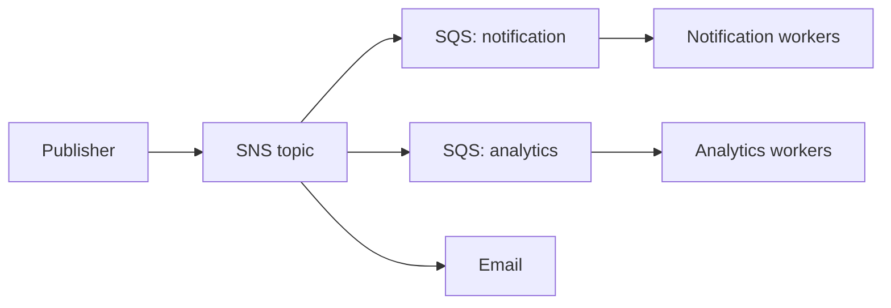

# Event-Driven and Distributed Processing

## 1 SQS vs SNS

Amazon SQS và Amazon SNS đều là dịch vụ messaging được quản lý bởi AWS, nhưng giải quyết hai nhu cầu khác nhau:

- **SQS** là message queue theo mô hình **poll/pull**, dùng để lưu và phân phối công việc cho consumer xử lý bất đồng bộ.
- **SNS** là dịch vụ notification theo mô hình **push**, dùng để gửi cùng một message đến nhiều subscriber gần như ngay lập tức. [14]

### Amazon SQS

```text
Producer → SQS Queue ← Consumer
```

Producer gửi message vào queue; consumer chủ động poll để nhận và xử lý. Message được giữ trong queue cho đến khi được xử lý hoặc hết thời gian retention.

SQS phù hợp khi cần:

- Tách producer khỏi consumer.
- Lưu message khi consumer chưa sẵn sàng.
- Xử lý công việc bất đồng bộ và retry khi lỗi.
- Điều tiết tải khi traffic tăng đột biến.
- Xử lý message theo batch.

Ví dụ xử lý đơn hàng:

```text
Khách hàng → SQS → Lambda → RDS
```

Nếu RDS tạm thời không hoạt động, message vẫn nằm trong queue để Lambda thử lại sau.

SQS có hai loại queue chính:

| Loại | Đặc điểm | Khi nên dùng |
|---|---|---|
| Standard | Thông lượng cao, at-least-once delivery, thứ tự best effort | Công việc độc lập; consumer chịu được message trùng hoặc sai thứ tự |
| FIFO | Giữ thứ tự trong message group và hỗ trợ deduplication khi gửi | Các thao tác cần tuần tự theo cùng một thực thể |

Consumer chỉ xóa message sau khi xử lý thành công. Nếu xử lý xong nhưng xóa thất bại, message có thể xuất hiện lại, vì vậy consumer vẫn cần **idempotency**. [1][2][3]

### Amazon SNS

```text
Publisher → SNS Topic → Subscriber A
                      → Subscriber B
                      → Subscriber C
```

Publisher gửi message đến topic; SNS push một bản sao đến từng subscriber. Subscriber có thể là SQS, Lambda, HTTP endpoint, email, SMS hoặc mobile push. [5]

SNS phù hợp khi cần:

- Gửi notification gần như tức thời.
- Fan-out cùng một event đến nhiều hệ thống.
- Gửi message cho cả ứng dụng và người dùng.

Ví dụ cảnh báo CPU:

```text
CloudWatch Alarm → SNS → Email cho quản trị viên
                       → Lambda xử lý tự động
```

Cùng một cảnh báo được gửi đồng thời đến con người và ứng dụng.

### So sánh nhanh

| Tiêu chí | Amazon SQS | Amazon SNS |
|---|---|---|
| Mô hình | Queue | Publish/subscribe |
| Cách nhận message | Consumer poll/pull | SNS push |
| Phân phối | Một consumer xử lý mỗi message trong một queue | Mọi subscriber nhận một bản sao |
| Lưu message | Có, tối đa 14 ngày | Không phải message store cho subscriber |
| Đối tượng nhận | Application-to-application | Application-to-application và application-to-person |
| Batching | Có | Không theo mô hình batching của SQS |
| Nhu cầu chính | Xử lý bất đồng bộ đáng tin cậy | Notification thời gian thực và fan-out |

Có thể ghi nhớ ngắn gọn:

> **SQS giữ và phân phối công việc; SNS phát thông báo đến nhiều nơi.**

### Kết hợp SNS và SQS

Hai dịch vụ thường được kết hợp để vừa fan-out vừa xử lý bền vững:



SNS gửi một bản sao đến mỗi SQS queue. Mỗi nhóm consumer có backlog, tốc độ scale, retry và DLQ riêng. Nếu Analytics tạm ngừng, message của nó vẫn được giữ trong queue mà không làm chậm Notification.

Khi dùng SNS → SQS, cần kiểm tra subscription dùng SNS envelope hay raw message delivery để consumer parse đúng body.

## 2 EventBridge

Amazon EventBridge là dịch vụ **serverless event bus** do AWS quản lý. Nó nhận event từ nhiều nguồn, lọc chúng bằng rule rồi chuyển đến target phù hợp gần như theo thời gian thực. [4][15]

```text
Event Source → Event Bus → Rule → Target
```

Ví dụ: khi ảnh được upload lên S3, EventBridge nhận event `ImageUploaded`, tìm rule phù hợp rồi gọi Lambda để resize ảnh.

```text
S3 → EventBridge → Lambda resize ảnh
                 → SNS gửi thông báo
                 → Analytics pipeline
```

Producer không cần gọi trực tiếp từng consumer. Nhờ đó, các service ít phụ thuộc nhau, có thể scale độc lập và lỗi ở một consumer ít lan sang consumer khác.

### Các thành phần chính

#### Event Source

Event Source là nơi phát sinh event:

- Dịch vụ AWS như S3, EC2, DynamoDB hoặc CloudTrail.
- Ứng dụng tự phát triển.
- Hệ thống SaaS như Shopify, Zendesk hoặc Datadog.

#### Event Bus

Event Bus tiếp nhận event trước khi phân phối:

- **Default Event Bus:** chủ yếu nhận event từ các dịch vụ AWS.
- **Custom Event Bus:** dành cho event của ứng dụng hoặc từng business domain.
- **Partner Event Bus:** nhận event từ đối tác SaaS.

Ví dụ, có thể dùng `ecommerce-bus` cho event đặt hàng và `analytics-bus` cho event phân tích để tách quyền truy cập và luồng xử lý.

Một số Event Bus và luồng sử dụng thường gặp:

| Event Bus | Event Source ví dụ | Rule ví dụ | Target ví dụ |
|---|---|---|---|
| Default Event Bus | EC2 thay đổi trạng thái | Chỉ nhận instance chuyển sang `stopped` | Lambda gửi cảnh báo |
| Default Event Bus | S3 tạo object mới | Chỉ nhận file trong bucket upload | Lambda xử lý file |
| Default Event Bus | CloudTrail ghi nhận AWS API call | Phát hiện thay đổi security group | SNS thông báo đội vận hành |
| `ecommerce-bus` | Order Service phát `OrderPlaced` | Lọc theo `detail-type` | SQS cho checkout worker |
| `payment-bus` | Payment Service phát `PaymentFailed` | Lọc giao dịch thất bại | Step Functions xử lý compensation |
| `analytics-bus` | Nhiều service phát business event | Lọc event cần phân tích | Kinesis hoặc Firehose |
| Partner Event Bus | SaaS như Zendesk hoặc Datadog | Lọc event theo loại của đối tác | Lambda, SQS hoặc SNS |

Event Bus chỉ là nơi tiếp nhận và định tuyến. Nếu target cần giữ backlog hoặc xử lý chậm hơn tốc độ event đến, nên route event từ bus vào SQS trước khi consumer xử lý.

#### Rule và Event Pattern

Rule dùng JSON pattern để chọn event cần chuyển tiếp. Có thể lọc theo `source`, `detail-type` hoặc field nằm trong `detail`.

**Ví dụ 1 — EC2 instance bị dừng:**

```json
{
  "source": ["aws.ec2"],
  "detail-type": ["EC2 Instance State-change Notification"],
  "detail": {
    "state": ["stopped"]
  }
}
```

Rule chỉ match khi EC2 chuyển sang trạng thái `stopped`. Target có thể là Lambda kiểm tra nguyên nhân hoặc SNS gửi cảnh báo cho đội vận hành.

```text
EC2 stopped → Default Event Bus → Rule → SNS/Lambda
```

**Ví dụ 2 — file mới được upload vào một S3 bucket:**

```json
{
  "source": ["aws.s3"],
  "detail-type": ["Object Created"],
  "detail": {
    "bucket": {
      "name": ["media-uploads"]
    }
  }
}
```

Rule bỏ qua event từ bucket khác và chỉ chuyển file trong `media-uploads` đến Lambda xử lý ảnh. Bucket cần bật gửi event đến EventBridge.

```text
S3 Object Created → Default Event Bus → Rule → ResizeImage Lambda
```

Qua 2 ví dụ, có thể đọc Event Pattern theo ba câu hỏi:

1. Event đến từ đâu? — `source`.
2. Event thuộc loại nào? — `detail-type`.
3. Chỉ quan tâm điều kiện cụ thể nào? — các field trong `detail`.

#### Target

Target là nơi nhận event, chẳng hạn Lambda, Step Functions, SQS, SNS, Kinesis, ECS task hoặc API Gateway.

Nếu consumer cần backlog, retry và điều tiết tốc độ, nên đặt SQS giữa EventBridge và consumer:

```text
EventBridge → SQS → Consumer
```

EventBridge định tuyến event, còn SQS giữ công việc cho đến khi consumer sẵn sàng xử lý.

### EventBridge Pipes

Pipes kết nối một source với một target mà không cần viết nhiều integration code:

```text
DynamoDB Stream → Pipe → Lambda
```

Pipe có thể:

- **Filter:** chỉ cho event phù hợp đi qua.
- **Enrich:** gọi dịch vụ khác để bổ sung dữ liệu.
- **Transform:** chuyển đổi cấu trúc event trước khi gửi.

Pipes phù hợp khi kết nối Kinesis hoặc DynamoDB Streams với Lambda, SQS và các dịch vụ downstream.

### EventBridge Scheduler

Scheduler kích hoạt công việc theo thời gian, hỗ trợ chạy một lần, theo rate hoặc cron expression.

```text
Mỗi ngày lúc 00:00 → EventBridge Scheduler → Lambda chạy ETL
```

Nó phù hợp với backup, đồng bộ dữ liệu, ETL và các workflow định kỳ.

### So sánh vai trò với SQS và SNS

| Dịch vụ | Vai trò chính |
|---|---|
| SQS | Lưu và phân phối công việc; consumer poll queue |
| SNS | Push cùng một message đến nhiều subscriber |
| EventBridge | Lọc và định tuyến event theo nội dung đến target phù hợp |

Ba dịch vụ có thể kết hợp với nhau. Không cần ghép chúng chỉ để “dùng đủ dịch vụ”; hãy chọn theo nhu cầu lưu công việc, fan-out hoặc định tuyến theo nội dung.

## 3 Transactional outbox

Transactional Outbox giải quyết bài toán **dual write**: ứng dụng cần cập nhật database và publish event đến message broker, nhưng hai thao tác không nằm trong cùng một local transaction. [7][16]

Ví dụ Payment Service thực hiện:

```text
1. Cập nhật payment thành PAID trong database
2. Publish event ORDER_PAID
```

Nếu bước 1 thành công nhưng ứng dụng crash trước bước 2, event bị mất và các service phía sau không biết đơn hàng đã được thanh toán.

### Cách hoạt động

Thay vì publish ngay, ứng dụng lưu business data và event vào bảng `outbox` trong cùng một database transaction:

```sql
BEGIN;

UPDATE payments
SET status = 'PAID'
WHERE order_id = 'ORDER-1001';

INSERT INTO outbox (
    event_id,
    event_type,
    aggregate_id,
    payload,
    status
)
VALUES (
    'EVENT-001',
    'ORDER_PAID',
    'ORDER-1001',
    '{"order_id": "ORDER-1001"}',
    'PENDING'
);

COMMIT;
```

Kết quả:

- Transaction thành công: payment và event cùng được lưu.
- Transaction thất bại: cả hai cùng rollback.
- Ứng dụng crash sau commit: event vẫn tồn tại trong database để gửi sau.

```text
Business Service
      ↓ local transaction
Business Data + Outbox Table
                        ↓
                 Relay Publisher
                        ↓
                  Message Broker
```

### Relay Publisher

Relay Publisher định kỳ đọc event chưa gửi trong bảng outbox:

1. Lấy event có trạng thái `PENDING`.
2. Publish event đến message broker.
3. Nếu broker xác nhận, đánh dấu event là `PUBLISHED`.
4. Nếu thất bại, retry sau.

Cách relay liên tục query bảng outbox được gọi là **Polling Publisher**. Nhiều relay chạy song song cần claim, lease hoặc database locking để tránh cùng lấy một batch; không nên giữ database transaction mở trong suốt một network call dài.

### Transaction Log Tailing

Một phương án khác là đọc transaction log của database:

- MySQL: binlog.
- PostgreSQL: WAL.

```text
Database Transaction Log
          ↓
Change Data Capture
          ↓
Message Broker
```

CDC phát hiện những thay đổi đã commit rồi chuyển chúng thành event. Cách này giảm polling trực tiếp vào bảng nhưng làm hạ tầng và vận hành phức tạp hơn.

### Ví dụ Notification Service

Notification Service lưu notification và outbox record trong cùng transaction. Sau đó, từng publisher gửi thông báo qua một channel riêng:

```text
notify_outbox
├── Email Publisher → Email provider
├── SMS Publisher   → SMS provider
└── Voice Publisher → Voice provider
```

Thiết kế này cho phép thêm hoặc scale từng channel độc lập. Mỗi publisher có retry và monitoring riêng theo đặc điểm của nhà cung cấp.

### Lợi ích

- **Atomicity:** business data và event cùng commit hoặc cùng rollback.
- **Durability:** event không mất sau khi business transaction đã commit.
- **Retry:** event chưa gửi thành công vẫn còn trong outbox.
- **Không cần distributed transaction:** chỉ dùng local transaction của database.
- **Theo dõi được:** có thể xem event đang chờ, đã gửi hoặc lỗi.

### Hạn chế

#### Duplicate event

Relay có thể publish thành công rồi crash trước khi cập nhật trạng thái:

```text
1. Publish EVENT-001 thành công
2. Relay crash trước khi đánh dấu PUBLISHED
3. Relay restart và publish EVENT-001 lần nữa
```

Vì vậy, Outbox thường cho **at-least-once delivery**, không bảo đảm end-to-end exactly once. Consumer phải idempotent, chẳng hạn lưu `event_id` đã xử lý và bỏ qua event trùng.

#### Near real-time

Polling tạo độ trễ giữa lúc transaction commit và lúc event được gửi. Poll thường xuyên giảm độ trễ nhưng tăng tải database.

#### Tăng chi phí database và vận hành

Ứng dụng phải ghi outbox record, query event chưa gửi, cập nhật trạng thái và dọn dữ liệu cũ. Với NoSQL, cần kiểm tra business data và outbox event có thể được ghi trong cùng atomic unit hay không.

#### Thứ tự không tự được bảo đảm

Có thể lưu sequence hoặc aggregate version để thể hiện thứ tự mong muốn, nhưng nhiều relay chạy song song vẫn có thể publish ngược thứ tự. Relay và consumer phải cùng có chiến lược xử lý ordering.

Có thể ghi nhớ ngắn gọn:

> **Lưu event cùng business data trước, rồi dùng Relay Publisher gửi event sau.**

## 4 Saga Pattern:

Saga Pattern quản lý distributed transaction giữa nhiều service độc lập. Thay vì một ACID transaction bao phủ tất cả database, Saga chia workflow thành nhiều **local transaction**. [8][17]

**ACID** là bốn tính chất giúp database transaction xử lý dữ liệu đáng tin cậy:

- **Atomicity:** toàn bộ transaction cùng thành công hoặc cùng rollback.
- **Consistency:** dữ liệu sau transaction vẫn tuân thủ constraint và quy tắc đã định.
- **Isolation:** các transaction chạy đồng thời không nhìn thấy trạng thái xử lý dở hoặc gây sai lệch cho nhau theo isolation level được chọn.
- **Durability:** dữ liệu đã commit vẫn tồn tại khi ứng dụng hoặc hệ thống khởi động lại.

Ví dụ chuyển 100.000 đồng từ tài khoản A sang B:

```text
1. Trừ 100.000 đồng từ A
2. Cộng 100.000 đồng vào B
```

ACID giúp bảo đảm không xảy ra trường hợp chỉ trừ tiền ở A mà chưa cộng vào B; giao dịch khác không thấy trạng thái chuyển dở; và kết quả không mất sau khi đã commit.

Mỗi bước của Saga:

1. Thực hiện transaction trong một service.
2. Nếu thành công, kích hoạt bước tiếp theo.
3. Nếu thất bại, chạy các **compensating transaction** để xử lý tác động của những bước đã hoàn thành.

Ví dụ quy trình đặt hàng:

```text
Tạo đơn → Thanh toán → Giữ tồn kho → Lên lịch giao hàng
```

Luồng thành công:

```text
ORDER_CREATED
      ↓
PAYMENT_COMPLETED
      ↓
INVENTORY_RESERVED
      ↓
DELIVERY_SCHEDULED
      ↓
ORDER_CONFIRMED
```

Nếu tồn kho không đủ sau khi đã thanh toán:

```text
PAYMENT_COMPLETED
      ↓
INVENTORY_FAILED
      ↓
REFUND_PAYMENT
      ↓
CANCEL_ORDER
```

### Compensating transaction

Compensation không phải database rollback thực sự. Nó là một nghiệp vụ mới để xử lý tác động của nghiệp vụ trước đó.

| Transaction đã thực hiện | Compensating transaction |
|---|---|
| Tạo đơn hàng | Hủy đơn hàng |
| Giữ tồn kho | Giải phóng tồn kho |
| Thu tiền | Hoàn tiền |
| Đặt lịch giao hàng | Hủy lịch giao hàng |

Hoàn tiền không xóa lịch sử đã từng thu tiền; email đã gửi cũng không thể thu hồi như rollback một row. Compensation có thể thất bại nên vẫn cần idempotency, retry, trạng thái bền vững và đường can thiệp thủ công.

### Choreography-based Saga

Không có bộ điều phối trung tâm. Mỗi service lắng nghe event, thực hiện local transaction rồi phát event tiếp theo:

```text
Order Service
    │ ORDER_CREATED
    ▼
Payment Service
    │ PAYMENT_COMPLETED
    ▼
Inventory Service
    │ INVENTORY_RESERVED
    ▼
Delivery Service
    │ DELIVERY_SCHEDULED
    ▼
Order Service → CONFIRMED
```

Khi Inventory phát `INVENTORY_FAILED`, Payment Service hoàn tiền và phát `PAYMENT_REFUNDED`; Order Service nhận event đó rồi hủy đơn.

**Ưu điểm:**

- Không có thành phần điều phối trung tâm.
- Các service không gọi trực tiếp lẫn nhau.
- Dễ thêm subscriber mới và scale từng consumer.

**Hạn chế:**

- Khó nhìn toàn bộ workflow.
- Logic điều phối phân tán trong nhiều service.
- Khó debug khi event chain dài hoặc có nhiều nhánh.
- Khó xác định service chịu trách nhiệm cho bước tiếp theo.

Choreography phù hợp với Saga ngắn, ít bước và luồng tương đối đơn giản.

### Orchestration-based Saga

Một **Saga Orchestrator** lưu trạng thái, gọi các service và quyết định bước tiếp theo:

```text
                  ┌→ Order Service
                  ├→ Payment Service
Saga Orchestrator ├→ Inventory Service
                  └→ Delivery Service
```

Orchestrator tạo đơn `PENDING`, yêu cầu thanh toán, giữ hàng và lên lịch giao. Nếu giữ hàng thất bại, nó yêu cầu hoàn tiền rồi hủy đơn.

**Ưu điểm:**

- Workflow tập trung, dễ theo dõi và debug.
- Dễ quản lý timeout, retry, branching và compensation.
- Phù hợp với quy trình dài hoặc có nhiều nhánh.

**Hạn chế:**

- Orchestrator có nhiều trách nhiệm và state machine có thể phức tạp.
- Có thể trở thành bottleneck hoặc single point of failure nếu không được thiết kế đủ tin cậy.
- Thêm bước mới thường phải cập nhật orchestrator.

Có thể triển khai orchestrator bằng application service riêng hoặc workflow engine như AWS Step Functions, tùy yêu cầu.

### So sánh hai cách triển khai

| Tiêu chí | Choreography | Orchestration |
|---|---|---|
| Điều phối | Phân tán qua event | Tập trung tại orchestrator |
| Theo dõi workflow | Khó hơn | Dễ hơn |
| Logic quy trình | Nằm trong nhiều service | Nằm chủ yếu ở orchestrator |
| Thêm consumer độc lập | Dễ subscribe event | Có thể phải cập nhật orchestrator |
| Phù hợp | Saga ngắn, đơn giản | Saga dài, nhiều nhánh |

### Eventual consistency trong Saga

Saga không cập nhật tất cả database cùng lúc. Trong một khoảng thời gian, trạng thái giữa các service có thể khác nhau:

```text
Payment Service: PAID
Order Service: PAYMENT_PENDING
```

Sau khi event thanh toán được xử lý, Order Service mới cập nhật. UI nên hiển thị trạng thái `PROCESSING` hoặc `PENDING`, thay vì giả định toàn bộ workflow hoàn thành ngay lập tức.

### Những vấn đề cần xử lý khi triển khai

- **Idempotency:** command hoặc event có thể được xử lý lại.
- **Retry:** lỗi tạm thời cần được thử lại có kiểm soát.
- **Timeout:** không chờ một service vô thời hạn.
- **Durable state:** trạng thái Saga phải tồn tại sau khi process restart.
- **Reliable messaging:** dùng Transactional Outbox để hạn chế mất event sau commit.
- **Ordering:** event có thể đến sai thứ tự hoặc event cũ đến muộn.
- **Observability:** dùng Saga ID hoặc correlation ID để theo dõi toàn workflow.
- **Manual intervention:** cần runbook khi compensation cũng thất bại.

Timeout Payment không đồng nghĩa với bị từ chối: tiền có thể đã được thu nhưng response bị mất. Trong trạng thái chưa rõ, cần tra cứu hoặc retry an toàn với cùng operation ID, không tạo một payment attempt mới tùy tiện.

### Khi nào nên dùng Saga?

Saga phù hợp khi workflow thay đổi dữ liệu ở nhiều microservice, mỗi service sở hữu database riêng và hệ thống chấp nhận eventual consistency. Mỗi bước quan trọng cũng phải có hành động bù hoặc một phương án xử lý ngoại lệ rõ ràng.

Nếu nghiệp vụ có thể nằm trong một service và một database transaction, local ACID transaction vẫn đơn giản và đáng tin cậy hơn.

Có thể ghi nhớ ngắn gọn:

> **Saga = chuỗi local transaction + compensating transaction khi có lỗi.**

## 5 Eventual consistency

**Eventual consistency** nghĩa là dữ liệu giữa các service có thể **chưa giống nhau ngay lập tức**, nhưng sẽ trở nên nhất quán sau khi event được truyền và xử lý xong.

### Ví dụ đơn giản

Khách hàng thanh toán một đơn hàng:

```text
1. Payment Service cập nhật: PAID
2. Payment Service phát event PAYMENT_COMPLETED
3. Event đang chờ trong queue
4. Order Service nhận event và cập nhật: CONFIRMED
```

Trong khoảng thời gian giữa bước 1 và bước 4, trạng thái có thể là:

```text
Payment Service: PAID
Order Service:   PAYMENT_PENDING
```

Hai service tạm thời chưa nhất quán. Sau khi Order Service xử lý event:

```text
Payment Service: PAID
Order Service:   CONFIRMED
```

Hệ thống đã **hội tụ** về trạng thái nhất quán.

### Điều cần hiểu

Eventual consistency không có nghĩa là “chờ một lúc thì dữ liệu tự đúng”. Hệ thống vẫn phải có:

- Cơ chế giao và retry event khi lỗi.
- Idempotency để xử lý event trùng an toàn.
- DLQ và cảnh báo cho event không xử lý được.
- Version hoặc timestamp để tránh event cũ ghi đè trạng thái mới.
- Monitoring để phát hiện đơn hàng bị `PENDING` quá lâu.

Trong thời gian chờ, UI nên hiển thị `Đang xử lý` thay vì báo thành công hoặc thất bại quá sớm.

Có thể ghi nhớ ngắn gọn:

> **Dữ liệu chưa đồng bộ ngay, nhưng cuối cùng sẽ đồng bộ nếu quá trình truyền và xử lý event hoạt động đúng.**

## 6 Idempotency

**Idempotency** nghĩa là xử lý cùng một yêu cầu nhiều lần nhưng kết quả nghiệp vụ chỉ xảy ra **một lần**.

### Ví dụ đơn giản

Payment Service nhận yêu cầu thu 100.000 đồng:

```text
PAYMENT_REQUESTED
event_id = EVENT-001
order_id = ORDER-1001
amount = 100000
```

Do retry, cùng message được giao hai lần:

```text
Lần 1 → thu 100.000 đồng
Lần 2 → không thu thêm vì EVENT-001 đã được xử lý
```

Nếu consumer không idempotent, khách hàng có thể bị thu 200.000 đồng.

### Cách xử lý

Consumer lưu `event_id` đã xử lý vào bảng `inbox`:

> **Chú thích:** `inbox` là bảng ghi dấu những event mà từng consumer đã xử lý. Khi event được giao lại, consumer kiểm tra bảng này để tránh thực hiện nghiệp vụ lần nữa. Có thể nhớ đơn giản: **outbox lưu event chờ gửi đi, inbox lưu event đã nhận và xử lý**.

```text
Nhận EVENT-001
      ↓
EVENT-001 đã có trong inbox?
      ├── Có   → bỏ qua tác động nghiệp vụ
      └── Chưa → xử lý và lưu EVENT-001 vào inbox
```

Mã giả:

```text
BEGIN TRANSACTION
    INSERT EVENT-001 vào inbox

    nếu insert thành công:
        cập nhật payment
COMMIT
```

Bảng `inbox` cần unique constraint trên `(consumer_name, event_id)`. Việc ghi inbox và cập nhật business data phải nằm trong cùng transaction để hai worker không cùng xử lý một event.

### Idempotency key

Key phải đại diện đúng cho thao tác cần chống lặp:

- `event_id`: chống xử lý lại cùng một event.
- `operation_id`: chống thực hiện lại cùng một thao tác, ví dụ cùng một lần thu tiền.
- `(consumer_name, event_id)`: cho phép Notification và Analytics xử lý cùng event độc lập.

Với payment, chỉ kiểm tra `event_id` đôi khi chưa đủ: hai event khác ID vẫn có thể yêu cầu cùng một lần thu tiền. Khi đó cần một `operation_id` ổn định như `PAY-ORDER-1001` và gửi key này cho payment provider nếu provider hỗ trợ idempotency.

### Điều cần nhớ

- Idempotency không ngăn message được gửi trùng; nó làm cho việc xử lý trùng trở nên an toàn.
- Gửi email hoặc gọi payment provider là side effect bên ngoài database, nên cần idempotency key hoặc cơ chế đối soát riêng.
- Phải giữ idempotency record đủ lâu để bao phủ retry, DLQ redrive và event replay.

Có thể ghi nhớ ngắn gọn:

> **Nhận cùng một yêu cầu nhiều lần, nhưng chỉ tạo ra một tác động nghiệp vụ.**

## 7 Retries

**Retry** là thử thực hiện lại một thao tác khi thao tác đó thất bại vì lỗi có khả năng chỉ xảy ra tạm thời.

### Ví dụ đơn giản

Order Service gọi Payment Service nhưng bị timeout:

```text
Lần 1 → timeout
chờ 1 giây
Lần 2 → timeout
chờ 2 giây
Lần 3 → thành công
```

Timeout hoặc lỗi mạng có thể biến mất sau một khoảng thời gian, vì vậy retry có thể giúp thao tác hoàn thành mà không cần con người can thiệp.

### Khi nào nên retry?

| Tình huống | Có retry không? | Lý do |
|---|---|---|
| Timeout, lỗi mạng tạm thời | Có | Service có thể hoạt động lại sau đó |
| Service trả `503` vì quá tải | Có | Lỗi thường mang tính tạm thời |
| Thanh toán bị từ chối | Không | Đây là kết quả nghiệp vụ, thử lại không làm thẻ hợp lệ hơn |
| Dữ liệu sai định dạng | Không | Phải sửa dữ liệu hoặc code |
| Thiếu quyền IAM | Không | Phải sửa cấu hình quyền |

### Không retry liên tục

Nếu retry ngay lập tức và liên tục, service đang lỗi có thể càng quá tải. Nên tăng thời gian chờ sau mỗi lần thất bại; cách này gọi là **exponential backoff**:

```text
Lần 1 thất bại → chờ 1 giây
Lần 2 thất bại → chờ 2 giây
Lần 3 thất bại → chờ 4 giây
Lần 4 thất bại → chờ 8 giây
```

Có thể thêm **jitter**, tức một khoảng ngẫu nhiên nhỏ, để nhiều worker không retry cùng một thời điểm.

### Retry phải có giới hạn

Mỗi retry policy cần xác định:

- Tối đa bao nhiêu lần thử.
- Tổng thời gian được phép retry.
- Khoảng chờ giữa các lần.
- Lỗi nào được phép retry.
- Làm gì sau khi hết số lần thử, ví dụ chuyển message vào DLQ.

```text
Xử lý message
      ↓ thất bại tạm thời
Retry tối đa 3 lần
      ↓ vẫn thất bại
Đưa vào DLQ để điều tra
```

### Retry và idempotency

Retry có thể khiến cùng một thao tác được gửi nhiều lần. Vì vậy, thao tác như thu tiền phải dùng cùng một `operation_id` hoặc idempotency key:

```text
Lần 1: charge(operation_id="PAY-1001") → timeout
Lần 2: charge(operation_id="PAY-1001") → provider trả lại kết quả cũ
```

Không tạo ID mới ở lần retry, vì provider có thể hiểu đó là một lần thu tiền mới.

Có thể ghi nhớ ngắn gọn:

> **Chỉ retry lỗi tạm thời, chờ lâu dần giữa các lần thử và luôn đặt giới hạn.**

## 8 DLQ: cô lập lỗi và phục hồi

**DLQ (Dead-Letter Queue)** là queue riêng dùng để giữ những message đã retry nhiều lần nhưng vẫn không thể giao hoặc xử lý thành công.

DLQ giúp cô lập message lỗi để message đó không tiếp tục làm nghẽn luồng chính và đội vận hành có thể điều tra sau.

### Ví dụ đơn giản

Payment worker nhận một message có schema không hợp lệ:

```text
Payment Queue
      ↓ nhận message
Worker xử lý thất bại
      ↓ retry lần 1
Worker vẫn thất bại
      ↓ retry lần 2, 3
Vượt quá giới hạn
      ↓
Payment DLQ
```

Các message hợp lệ khác vẫn tiếp tục được xử lý trong queue chính. Message lỗi được giữ riêng trong DLQ để kiểm tra.

### DLQ không tự sửa lỗi

DLQ chỉ lưu message và không tự:

- Sửa dữ liệu sai.
- Sửa bug của consumer.
- Cấp lại quyền IAM.
- Khôi phục dependency đang lỗi.
- Đưa message trở lại queue chính.

Sau khi sửa nguyên nhân, đội vận hành mới **redrive**, tức chuyển message từ DLQ về queue nguồn để xử lý lại.

### Một số loại DLQ trên AWS

| DLQ | Giữ loại lỗi nào? | Ví dụ |
|---|---|---|
| SQS consumer DLQ | Consumer nhận nhiều lần nhưng xử lý vẫn lỗi | Worker không đọc được schema |
| EventBridge target DLQ | EventBridge không giao được event đến target | Target thiếu quyền hoặc không khả dụng |
| SNS subscription DLQ | SNS không giao được message đến subscriber | HTTP endpoint liên tục thất bại |

Các DLQ này nằm ở những chặng khác nhau. Message vào EventBridge target DLQ chưa từng đến consumer; message vào SQS consumer DLQ đã đến queue nhưng consumer xử lý thất bại. [10][12][13]

### Cấu hình cơ bản với SQS

`maxReceiveCount` quy định số lần message được nhận từ queue nguồn trước khi chuyển sang DLQ:

```text
maxReceiveCount = 3

Lần nhận 1 → thất bại
Lần nhận 2 → thất bại
Lần nhận 3 → thất bại
Lần tiếp theo → chuyển vào DLQ
```

Giá trị phù hợp phụ thuộc vào loại lỗi, thời gian xử lý và yêu cầu nghiệp vụ; không có một con số đúng cho mọi hệ thống.

### Cách phục hồi message

Không nên redrive toàn bộ message ngay lập tức. Quy trình an toàn:

1. Đọc lỗi và xác định service chịu trách nhiệm.
2. Sửa nguyên nhân như bug, permission hoặc dependency.
3. Kiểm tra message còn hợp lệ về nghiệp vụ hay không.
4. Bảo đảm consumer idempotent để replay không tạo tác động trùng.
5. Redrive một nhóm nhỏ với tốc độ giới hạn.
6. Theo dõi kết quả rồi mới tăng dần số lượng.

Ví dụ: không nên replay yêu cầu thu tiền cũ trước khi kiểm tra giao dịch đó đã được thu hay hoàn tiền chưa.

Có thể ghi nhớ ngắn gọn:

> **DLQ là khu vực cách ly message lỗi: giữ lại để điều tra, sửa nguyên nhân rồi xử lý lại an toàn.**
## 9 Quiz: Event-Driven and Distributed Processing

### Câu hỏi

1. SQS thường dùng theo mô hình nào?
   - A. Hàng đợi message
   - B. Database quan hệ
   - C. Object storage
   - D. Web browser
2. SNS phù hợp khi cần làm gì?
   - A. Phát một message đến nhiều subscriber
   - B. Chạy truy vấn SQL
   - C. Lưu file lớn
   - D. Render HTML
3. EventBridge giúp định tuyến event dựa trên gì?
   - A. Rule và nội dung event
   - B. Màu giao diện
   - C. CPU của consumer
   - D. Tên biến Python
4. Transactional outbox giải quyết rủi ro nào?
   - A. Database đã commit nhưng event chưa được gửi
   - B. User quên mật khẩu
   - C. File CSS quá lớn
   - D. DNS hết hạn
5. Saga quản lý điều gì?
   - A. Giao dịch gồm nhiều bước phân tán
   - B. Một phép cộng đơn giản
   - C. Một file cấu hình
   - D. Một HTTP header
6. Eventual consistency nghĩa là gì?
   - A. Các bản sao có thể lệch tạm thời nhưng hội tụ sau đó
   - B. Dữ liệu luôn sai
   - C. Không cần lưu dữ liệu
   - D. Mọi thay đổi xảy ra tức thì ở mọi nơi
7. Idempotency giúp consumer xử lý an toàn điều gì?
   - A. Message bị giao lặp
   - B. Màn hình bị tối
   - C. CPU bị nóng
   - D. File bị nén
8. Retry nên có thêm cơ chế nào để tránh gọi dồn dập?
   - A. Backoff
   - B. Xóa log
   - C. Tắt timeout
   - D. Đổi tên queue
9. DLQ chứa loại message nào?
   - A. Message không xử lý được sau số lần thử cho phép
   - B. Mọi message thành công
   - C. Chỉ message mới
   - D. Chỉ file ảnh
10. Consumer nên làm gì trước khi thực hiện lại tác động của một message?
    - A. Kiểm tra idempotency key hoặc trạng thái đã xử lý
    - B. Luôn tạo dữ liệu mới
    - C. Xóa database
    - D. Bỏ qua message

### Đáp án

1. **A**; 2. **A**; 3. **A**; 4. **A**; 5. **A**; 6. **A**; 7. **A**; 8. **A**; 9. **A**; 10. **A**.
