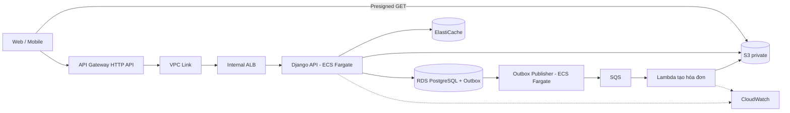

# AWS Cloud-Native Development

## 1 Bài toán mở đầu và kiến trúc đề xuất

Hệ thống Orders gồm Django API tiếp nhận đơn hàng, **background processing**, Lambda tạo hóa đơn và chức năng cho khách hàng tải hóa đơn.

Trong đợt khuyến mãi, số ECS task tự động tăng. CPU giảm nhưng mỗi task mở thêm database connection, khiến RDS quá tải:

```text
Nhiều ECS task → nhiều process → nhiều DB connection → RDS lỗi
```

Hóa đơn đang được lưu trên filesystem của container. Khi task bị thay thế, file cũng bị mất vì filesystem này không phải nơi lưu trữ bền vững.

Bài toán cần giải quyết:

1. Scale compute mà không làm quá tải RDS và các dependency khác.
2. Không lưu dữ liệu nghiệp vụ lâu dài trên filesystem của container.
3. Không làm mất công việc tạo hóa đơn khi consumer tạm thời không sẵn sàng.
4. Tách request đồng bộ khỏi quá trình tạo hóa đơn chạy nền.

### Kiến trúc đề xuất



Vai trò của từng thành phần:

- **API Gateway:** xác thực, định tuyến và giới hạn request.
- **Internal ALB:** phân phối request đến các Django task.
- **ECS/Fargate:** chạy Django API và Outbox Publisher.
- **RDS PostgreSQL:** lưu Orders và Outbox trong transaction.
- **ElastiCache:** cache dữ liệu đọc nhiều để giảm tải RDS.
- **SQS:** giữ công việc tạo hóa đơn cho đến khi Lambda sẵn sàng.
- **Lambda:** nhận message từ SQS và tạo hóa đơn.
- **S3:** lưu hóa đơn bền vững trong private bucket.
- **IAM:** giới hạn quyền của từng workload.
- **VPC:** kiểm soát đường mạng giữa các thành phần.
- **CloudWatch:** theo dõi API, ECS, RDS, SQS và Lambda.

### Cách kiến trúc giải quyết bài toán

**Bảo vệ RDS:** ECS không scale chỉ dựa trên CPU. Số task tối đa phải tính theo database connection budget:

```text
DB connection có thể cấp cho ứng dụng
÷ connection tối đa của mỗi task
= số task tối đa an toàn
```

**Không mất hóa đơn:** Lambda lưu hóa đơn vào S3 thay vì filesystem của ECS hoặc Lambda.

**Không làm mất background job:** Order và event được lưu vào RDS Outbox trong cùng transaction. Outbox Publisher chuyển event đến SQS; queue giữ message nếu Lambda chưa sẵn sàng.

**Phản hồi API nhanh hơn:** Django tiếp nhận đơn và lưu dữ liệu cần thiết; quá trình tạo hóa đơn được tách ra xử lý bất đồng bộ.

> Kiến trúc tách API, dữ liệu giao dịch, background processing và object storage; mỗi thành phần được scale theo giới hạn của dependency thay vì chỉ tăng compute độc lập.

## 2 API Gateway: quản lý đầu vào

> **Chức năng chính:** Cung cấp điểm vào HTTP được quản lý, hỗ trợ routing, authentication, throttling và tích hợp với backend.
>
> **Áp dụng:** Nhận request từ Web/Mobile, xác thực token, giới hạn lưu lượng rồi chuyển request qua VPC Link và internal ALB đến Django. Django vẫn chịu trách nhiệm kiểm tra người dùng có quyền truy cập từng order hay không.

Trong thiết kế Orders, gateway xác thực token, định tuyến và giới hạn lưu lượng; Django kiểm tra quyền trên từng đơn. API key phục vụ nhận diện/đo mức sử dụng theo cấu hình, không thay thế danh tính người dùng hoặc object authorization.

Hợp đồng `POST /orders` cần nêu rõ response là đã tiếp nhận hay đã hoàn tất checkout. Một timeout tại gateway không chứng minh backend đã rollback. Client retry thao tác ghi cần idempotency key và endpoint tra cứu kết quả. Tác vụ dài nên được tiếp nhận bền vững dưới dạng **background job** thay vì kéo dài chuỗi HTTP không giới hạn.

## 3 Internal ALB: phân phối request đến Django

> **Chức năng chính:** Application Load Balancer nhận HTTP/HTTPS request trong VPC, kiểm tra health và phân phối request đến các Django ECS task còn hoạt động.
>
> **Áp dụng:** API Gateway đi qua VPC Link để gọi Internal ALB. ALB chọn một healthy Django task trong target group, nhờ đó có thể thêm, thay thế hoặc rollout task mà client không cần biết địa chỉ IP của từng container.

Trong kiến trúc Orders, ALB có scheme `internal`, nên không nhận kết nối trực tiếp từ Internet:

```text
Web/Mobile
    ↓
API Gateway
    ↓ VPC Link
Internal ALB
    ├──→ Django Task 1
    ├──→ Django Task 2
    └──→ Django Task 3
```

API Gateway cung cấp public API và các chức năng như authentication hoặc throttling. Internal ALB đảm nhiệm load balancing bên trong VPC. AWS hỗ trợ private integration từ API Gateway đến ALB hoặc ECS resource thông qua VPC Link. [AWS — API Gateway private integrations](https://docs.aws.amazon.com/apigateway/latest/developerguide/http-api-develop-integrations-private.html).

### Target group và health check

Mỗi Django ECS task được đăng ký vào ALB target group. ALB chỉ gửi request đến target vượt qua health check, ví dụ:

```text
GET /health/ready

200 → task sẵn sàng nhận request
503 → task chưa sẵn sàng, không route traffic vào
```

Readiness endpoint nên kiểm tra ứng dụng đã khởi động và có thể phục vụ request, nhưng không nên chạy query nặng ở mỗi lần health check. Khi rollout, task mới chỉ nhận traffic sau khi healthy; task cũ cần được drain để hoàn tất request đang xử lý trước khi dừng.

### Security group

Luồng mạng được giới hạn theo security group:

```text
VPC Link → ALB listener
ALB security group → Django task security group → application port
```

Django task chỉ cho phép inbound từ security group của ALB, không mở application port cho toàn VPC hoặc Internet. ALB không thay thế authentication và object authorization trong Django.

### Vì sao không gọi thẳng từng ECS task?

- IP của Fargate task có thể thay đổi khi scale hoặc deploy.
- ALB tự cập nhật danh sách healthy target qua ECS service integration.
- Request được phân phối giữa nhiều task và nhiều Availability Zone.
- Có một listener ổn định để API Gateway tích hợp.

Nếu hệ thống không cần API Gateway, có thể cân nhắc public ALB làm entry point trực tiếp. Trong kiến trúc đề xuất, Internal ALB được giữ private vì API Gateway là public entry point duy nhất.

## 4 ECS / Fargate: chạy Django và Outbox Publisher

> **Chức năng chính:** ECS điều phối container; Fargate cung cấp compute để chạy container mà không cần quản lý EC2 host.
>
> **Áp dụng:** Chạy Django API và Outbox Publisher thành hai ECS service riêng. API scale theo HTTP traffic; Publisher scale theo số Outbox event chờ gửi; cả hai phải bị giới hạn bởi ngân sách connection của RDS.

ECS điều phối workload container. Task definition mô tả image, tài nguyên, biến môi trường và cấu hình chạy; task là một lần thực thi; service duy trì số task mong muốn. Fargate cung cấp compute mà nhóm không phải quản lý các EC2 host. [AWS — Fargate](https://docs.aws.amazon.com/AmazonECS/latest/developerguide/AWS_Fargate.html).

### Phân tách workload

| Workload trong ví dụ | Cách chạy đề xuất | Lý do |
|---|---|---|
| Django HTTP API | ECS service sau ALB | Cần phục vụ liên tục và rolling deployment |
| Outbox Publisher | ECS service riêng | Đọc Outbox và publish event đến SQS độc lập với HTTP traffic |
| Migration | Một task có điều phối trong pipeline | Tránh nhiều replica cùng chạy migration |
| Backfill dữ liệu | Task riêng, checkpoint và giới hạn tốc độ | Có thể dừng/tiếp tục, không chiếm task phục vụ khách |


### Scale có ngân sách dependency

Giả sử mỗi task có 4 process, mỗi process giữ tối đa 5 connection. Mười task có thể tạo khoảng `10 × 4 × 5 = 200` connection, chưa tính Publisher, migration và task tăng thêm lúc rollout. Đây là mô hình ước lượng; phải đo theo server và pool thực tế.

Thiết kế giới hạn task tối đa theo ngân sách connection, giữ phần dự phòng cho vận hành và giới hạn concurrent request. CPU thấp nhưng queue chờ DB dài là lý do kiểm tra dependency trước khi tăng replica.

## 5 RDS: dữ liệu giao dịch và phục hồi

> **Chức năng chính:** Cung cấp relational database được quản lý cho transaction, constraint, backup và failover.
>
> **Áp dụng:** Lưu Orders và Outbox trong PostgreSQL bằng cùng local transaction. Thiết kế connection budget, migration an toàn và quy trình backup/PITR để việc scale ECS không làm database quá tải.

RDS cung cấp database được quản lý; Django vẫn chịu trách nhiệm schema, transaction, index và query. Với Multi-AZ DB instance deployment, standby phục vụ failover và không phục vụ read traffic. Multi-AZ DB cluster có cấu trúc khác và reader có thể phục vụ đọc. [AWS — RDS Multi-AZ](https://docs.aws.amazon.com/AmazonRDS/latest/UserGuide/Concepts.MultiAZ.html).

### Thiết kế Orders

- Ghi order và outbox trong cùng transaction; unique constraint bảo vệ idempotency key đúng phạm vi tenant.
- Giữ transaction ngắn; không chờ Payment HTTP trong khi giữ lock DB.
- Với yêu cầu đọc ngay sau ghi, đọc nguồn có bảo đảm nhất quán phù hợp; read replica có thể chậm cập nhật.
- Giới hạn connection và timeout. Pool hoặc RDS Proxy cần được kiểm tra với session state, transaction và engine thực tế.
- Dùng migration tương thích với cả version ứng dụng cũ và mới trong giai đoạn rollout.

### Availability khác với recovery

**Availability** giúp database tiếp tục phục vụ khi hạ tầng gặp lỗi. Ví dụ, RDS Multi-AZ có thể failover sang standby khi DB instance chính bị hỏng.

**Recovery** khôi phục dữ liệu sau khi dữ liệu bị xóa hoặc cập nhật sai. Trường hợp này cần backup hoặc Point-in-Time Recovery (PITR).

```text
DB instance bị hỏng → Failover          → Availability
Xóa nhầm Orders     → Restore backup    → Recovery
```

Multi-AZ không thay thế backup: standby thường chứa cả thay đổi sai đã được đồng bộ. Ngược lại, chỉ có backup cũng không giúp hệ thống tiếp tục phục vụ ngay khi DB chính gặp lỗi.

- **RPO:** có thể chấp nhận mất tối đa bao nhiêu dữ liệu.
- **RTO:** hệ thống phải được phục hồi trong bao lâu.

**Ví dụ:** hệ thống có `RPO = 5 phút` và `RTO = 30 phút` nghĩa là khi sự cố xảy ra:

- Có thể mất tối đa dữ liệu Orders phát sinh trong 5 phút gần nhất.
- Database và ứng dụng phải hoạt động trở lại trong vòng 30 phút.

Sau khi restore Orders DB, vẫn phải kiểm tra và đối soát với các hệ thống bên ngoài. Restore database không tự hoàn tiền hoặc thay đổi trạng thái tại payment provider.

## 6 ElastiCache: giảm tải với dữ liệu có thể tái tạo

> **Chức năng chính:** Lưu dữ liệu thường dùng trong memory để giảm latency và giảm số lần đọc nguồn dữ liệu chính.
>
> **Áp dụng:** Cache product catalog hoặc read projection của Orders; không dùng cache làm nguồn quyết định tồn kho hay thanh toán. Khi cache lỗi, fallback phải có giới hạn để không tạo miss storm làm sập RDS.

ElastiCache quản lý kho dữ liệu trong bộ nhớ, hỗ trợ các lựa chọn engine như Valkey, Redis OSS và Memcached. Đặc tính cụ thể phụ thuộc engine và kiểu triển khai. [AWS — ElastiCache](https://docs.aws.amazon.com/AmazonElastiCache/latest/dg/WhatIs.html).

Cache-aside đọc cache trước, khi miss thì đọc nguồn và điền cache. TTL giới hạn thời gian tồn tại của entry nhưng không tự giải quyết mọi race cập nhật. [AWS — Caching strategies](https://docs.aws.amazon.com/AmazonElastiCache/latest/dg/Strategies.html).

Trong Orders, cache danh mục sản phẩm hoặc bản chiếu đọc có thể chấp nhận độ trễ. Quyết định giữ tồn kho và xác nhận thanh toán vẫn dựa vào nguồn dữ liệu nghiệp vụ. Key đề xuất là `tenant:{tenant_id}:catalog:v2:{product_id}` để tránh lẫn tenant và cho phép đổi schema cache.

Hit rate cao chưa đủ kết luận tốt: cần đo latency, miss cost, lượng dữ liệu stale và tải DB khi cache lạnh.

## 7 Lambda: tạo hóa đơn theo sự kiện

**AWS Lambda** chạy một function khi có event. Không cần duy trì một server hoặc container luôn hoạt động; khi SQS có message, AWS gọi function, function xử lý xong rồi kết thúc.

### Ví dụ tạo hóa đơn

Sau khi Order được tạo, Outbox Publisher gửi một message vào SQS:

```json
{
  "event_id": "evt-1001",
  "order_id": "ORDER-1001",
  "invoice_version": 1
}
```

Luồng xử lý:

```text
RDS Outbox
    ↓
Outbox Publisher
    ↓
SQS giữ message
    ↓
Lambda được kích hoạt
    ↓
Đọc dữ liệu Order → tạo file PDF → upload S3
```

Lambda thực hiện các bước:

1. Đọc `order_id` và `invoice_version` từ message.
2. Lấy dữ liệu cần thiết của Order.
3. Tạo file hóa đơn PDF.
4. Upload file vào private S3 bucket.
5. Ghi nhận hóa đơn đã được tạo thành công.

Object key nên được xác định ổn định, ví dụ:

```text
invoices/ORDER-1001/v1.pdf
```

### Vì sao dùng Lambda?

- Tạo hóa đơn là tác vụ ngắn và chỉ chạy khi có Order cần xử lý.
- Django không phải giữ HTTP request trong lúc tạo PDF.
- SQS giữ message nếu Lambda hoặc dependency tạm thời lỗi.
- Lambda có thể tự tăng số invocation khi số message tăng.

### Xử lý message trùng

SQS có thể giao lại cùng một message. Ví dụ Lambda đã upload file nhưng lỗi trước khi ghi trạng thái hoàn tất; message sẽ được xử lý lại.

Lambda phải **idempotent**:

```text
ORDER-1001, version 1 đã có hóa đơn?
├── Có   → không tạo thêm bản trùng
└── Chưa → tạo và lưu invoices/ORDER-1001/v1.pdf
```

Không dùng biến trong RAM để ghi nhớ vì execution environment có thể bị thay thế. Trạng thái phải nằm trong RDS, DynamoDB hoặc một nơi lưu trữ bền vững. [AWS — Lambda best practices](https://docs.aws.amazon.com/lambda/latest/dg/best-practices.html).

### Giới hạn concurrency

Nếu SQS có 10.000 message, Lambda có thể chạy nhiều invocation cùng lúc. Điều này xử lý nhanh hơn nhưng cũng có thể làm quá tải RDS.

```text
Concurrency cao → nhiều query đồng thời → RDS quá tải
```

Vì vậy cần giới hạn concurrency và batch size theo khả năng của RDS, không chỉ theo khả năng scale của Lambda.

Có thể ghi nhớ ngắn gọn:

> **SQS giữ công việc; Lambda lấy công việc, tạo hóa đơn và lưu kết quả bền vững vào S3.**

## 8 S3: object storage và quyền tải hóa đơn

> **Chức năng chính:** Lưu object bền vững như file, ảnh, hóa đơn và dữ liệu export, tách khỏi filesystem tạm thời của compute.
>
> **Áp dụng:** Lambda ghi hóa đơn vào private S3 bucket; Django kiểm tra quyền sở hữu order rồi tạo presigned GET URL ngắn hạn để client tải trực tiếp.

S3 phù hợp với object như hóa đơn, media và export. Presigned URL cấp quyền tạm thời theo credential của bên ký; URL có thể được dùng nhiều lần trong thời hạn hiệu lực và có thể hết hiệu lực sớm nếu credential hết hạn. [AWS — Presigned URLs](https://docs.aws.amazon.com/AmazonS3/latest/userguide/using-presigned-url.html).

### Presigned URL được dùng như thế nào?

Presigned URL cho phép người dùng tải một hóa đơn cụ thể từ private S3 bucket trong thời gian ngắn mà không cần AWS credential và không cần truyền file qua Django.

Luồng tải hóa đơn:

1. Client gọi `GET /orders/{order_id}/invoice` sau khi đăng nhập.
2. Django kiểm tra người dùng có quyền truy cập order và tenant đó hay không.
3. Django lấy S3 object key từ metadata đáng tin cậy trong database.
4. Django tạo Presigned GET URL có thời hạn ngắn, ví dụ 5 phút.
5. Client dùng URL để tải hóa đơn trực tiếp từ private S3 bucket.

```text
Client ── yêu cầu tải hóa đơn ──► Django API
                                   ├── xác thực người dùng
                                   ├── kiểm tra quyền với Order
                                   └── tạo Presigned GET URL
                                                │
Client ◄──────────── URL tạm thời ──────────────┘
   │
   └──────── tải trực tiếp ────────► Private S3 Bucket
```

Nếu không dùng Presigned URL, Django phải đọc file từ S3 rồi truyền lại cho client:

```text
S3 → Django/ECS → Client
```

Với Presigned URL, dữ liệu đi trực tiếp từ S3 đến client:

```text
S3 → Client
```

Cách này giảm bandwidth, memory và thời gian giữ connection của Django/ECS. S3 bucket vẫn private và client không được cấp access key hoặc IAM role.

## 9 IAM: quyền của workload

> **Chức năng chính:** Xác định identity nào được phép thực hiện action nào trên resource AWS nào.
>
> **Áp dụng:** Lambda tạo hóa đơn chỉ có quyền ghi đúng S3 prefix; Django API chỉ có quyền đọc để ký URL; ECS execution role kéo image/gửi log và tách khỏi task role của application.

Task role cung cấp quyền AWS cho code trong container. Task execution role dùng cho các thao tác ECS cần thực hiện để khởi chạy task như kéo image và gửi log theo cấu hình. Hai vai trò này cần tách biệt. [AWS — ECS task IAM role](https://docs.aws.amazon.com/AmazonECS/latest/developerguide/task-iam-roles.html).

Ví dụ identity policy cho một worker chỉ được ghi vùng hóa đơn; tên bucket là placeholder, policy này không bao gồm trust policy hoặc quyền KMS nếu dùng customer managed key:

```json
{
  "Version": "2012-10-17",
  "Statement": [
    {
      "Effect": "Allow",
      "Action": "s3:PutObject",
      "Resource": "arn:aws:s3:::example-orders-invoices/invoices/*"
    }
  ]
}
```

API ký GET cần quyền đọc tương ứng, không mặc định dùng chung role ghi của worker. Role runtime không được quyền sửa hạ tầng; role deploy không được tự do đọc dữ liệu khách hàng. Dùng credential tạm thời qua role và review least privilege theo thao tác thực tế. [AWS — IAM best practices](https://docs.aws.amazon.com/IAM/latest/UserGuide/best-practices.html).

## 10 VPC: đường mạng và phạm vi truy cập

**VPC (Virtual Private Cloud)** là mạng riêng của hệ thống trên AWS. VPC quyết định các thành phần được đặt ở đâu và có đường mạng để kết nối đến đâu.

Trong kiến trúc Orders, Django, RDS và ElastiCache không cần nhận kết nối trực tiếp từ Internet nên được đặt trong private subnet.

```text
Internet
   ↓
API Gateway
   ↓ VPC Link
Internal ALB
   ↓
Django ECS Tasks
   ├──→ RDS PostgreSQL
   ├──→ ElastiCache
   └──→ S3 qua VPC Endpoint
```

### Subnet là gì?

Subnet là một phần nhỏ của VPC dùng để đặt resource.

- **Public subnet:** có route trực tiếp đến Internet Gateway; thường dành cho resource cần nhận traffic Internet.
- **Private subnet:** không có route trực tiếp nhận traffic từ Internet.

Trong thiết kế này:

| Thành phần | Vị trí đề xuất | Lý do |
|---|---|---|
| Internal ALB | Private subnets | Chỉ API Gateway truy cập qua VPC Link |
| Django ECS tasks | Private subnets | Không mở trực tiếp cho Internet |
| RDS | Private DB subnets | Chỉ application được kết nối |
| ElastiCache | Private cache subnets | Chỉ application được kết nối |

### Security Group là gì?

Security Group là firewall gắn với resource. Nó quy định resource nào được phép kết nối đến resource nào và qua port nào. [AWS — Security groups](https://docs.aws.amazon.com/vpc/latest/userguide/vpc-security-groups.html).

Ví dụ:

```text
ALB Security Group
    └── được gọi Django port 8000

Django Security Group
    ├── được gọi PostgreSQL port 5432
    └── được gọi Redis/Valkey port cần thiết

RDS Security Group
    └── chỉ nhận port 5432 từ Django Security Group
```

Không mở RDS bằng quy tắc `0.0.0.0/0`. Database chỉ nên nhận kết nối từ security group của workload thực sự cần truy cập.

Security Group kiểm soát **đường mạng**, còn IAM kiểm soát **quyền gọi AWS API**. Có đường mạng đến S3 không đồng nghĩa task có quyền đọc object; task vẫn cần IAM permission phù hợp.

Có thể ghi nhớ ngắn gọn:

> **VPC tạo mạng riêng; subnet chia khu vực đặt resource; route tạo đường đi; Security Group quyết định kết nối nào được phép.**

## 11 CloudWatch: quan sát khả năng phục vụ

> **Chức năng chính:** Thu thập metrics, logs và alarms để quan sát sức khỏe hạ tầng và ứng dụng.
>
> **Áp dụng:** Liên kết HTTP latency/5xx với ECS task, RDS connection, SQS message age, Lambda error và số order hoàn tất để phát hiện trường hợp CPU bình thường nhưng database hoặc workflow đang nghẽn.

CloudWatch cung cấp metrics, logs, alarms và dashboard cho tài nguyên/ứng dụng AWS. Telemetry nghiệp vụ cần được ứng dụng phát ra hoặc được thu thập qua pipeline phù hợp. [AWS — CloudWatch](https://docs.aws.amazon.com/AmazonCloudWatch/latest/monitoring/WhatIsCloudWatch.html).

Dashboard Orders đề xuất:

| Lớp | Tín hiệu | Câu hỏi được giải đáp |
|---|---|---|
| Đầu vào | Request rate, 5xx, latency theo route | Khách có đang bị ảnh hưởng? |
| Compute | Task count, restart, CPU, memory | Workload có bị giới hạn tài nguyên? |
| Database | Connections, query/lock latency, storage | Scale ứng dụng có làm nghẽn DB? |
| Queue/Lambda | Tuổi message, lỗi, throttling, DLQ | Công việc có hoàn tất đúng hạn? |
| Nghiệp vụ | Đơn nhận/hoàn tất/thất bại | HTTP thành công có phản ánh kết quả thực? |

Log JSON nên có service, environment, release và trace reference. Không đưa token hoặc dữ liệu thẻ vào log; đặt retention và quyền đọc. Alarm cần owner, mức tác động và runbook. CloudTrail phù hợp với việc truy vết thao tác AWS được ghi nhận; nó không thay cho application log hoặc metric trải nghiệm khách hàng.
## 12 Quiz: AWS Cloud-Native Development

### Câu hỏi

1. API Gateway thường dùng để làm gì?
   - A. Quản lý đầu vào API
   - B. Lưu file
   - C. Chạy truy vấn SQL
   - D. Thay thế VPC
2. Application Load Balancer phân phối gì?
   - A. Request đến các target khỏe mạnh
   - B. Mật khẩu đến user
   - C. File vào database
   - D. Source code vào Git
3. AWS Fargate cho phép chạy container mà không cần làm gì?
   - A. Quản lý trực tiếp máy chủ nền
   - B. Tạo image
   - C. Viết ứng dụng
   - D. Cấu hình port
4. Amazon RDS phù hợp để lưu loại dữ liệu nào?
   - A. Dữ liệu quan hệ
   - B. Chỉ file video
   - C. Container image
   - D. DNS record
5. ElastiCache thường giúp ích gì?
   - A. Giảm tải nguồn dữ liệu chính
   - B. Thay thế IAM
   - C. Tạo VPC
   - D. Biên dịch Python
6. AWS Lambda phù hợp với công việc nào?
   - A. Xử lý ngắn theo sự kiện
   - B. Lưu object lâu dài
   - C. Quản lý subnet
   - D. Thay thế mọi database
7. Amazon S3 là dịch vụ gì?
   - A. Object storage
   - B. Message queue
   - C. Relational database
   - D. Container runtime
8. IAM role của workload nên tuân theo nguyên tắc nào?
   - A. Least privilege
   - B. Cấp toàn quyền
   - C. Dùng chung mật khẩu
   - D. Tắt audit
9. Private subnet thường được dùng cho thành phần nào?
   - A. Thành phần không cần nhận kết nối trực tiếp từ Internet
   - B. Trang web công khai bắt buộc
   - C. DNS toàn cầu
   - D. Máy người dùng
10. CloudWatch hỗ trợ việc gì?
    - A. Thu thập metric, log và tạo cảnh báo
    - B. Viết domain model
    - C. Thay thế source control
    - D. Thiết kế giao diện

### Đáp án

1. **A**; 2. **A**; 3. **A**; 4. **A**; 5. **A**; 6. **A**; 7. **A**; 8. **A**; 9. **A**; 10. **A**.
