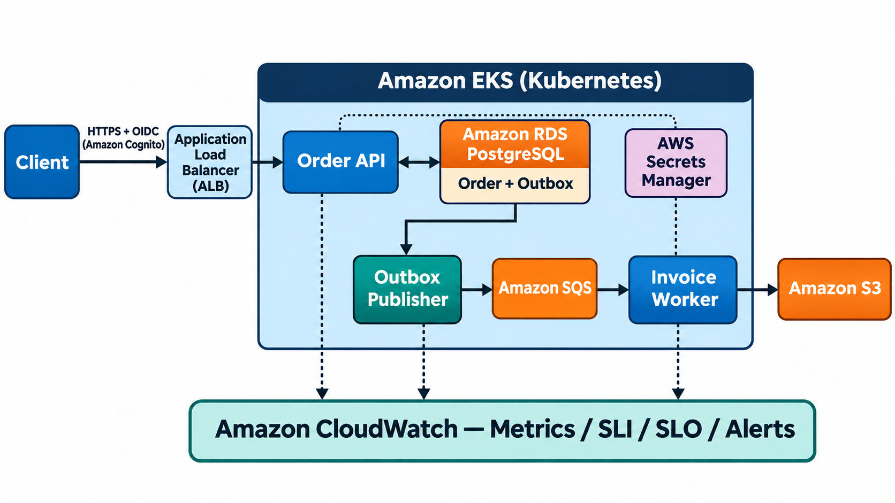
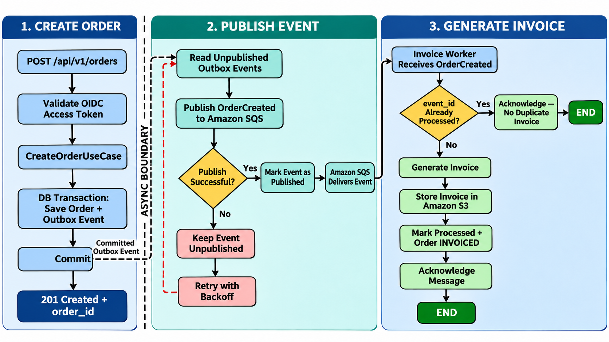
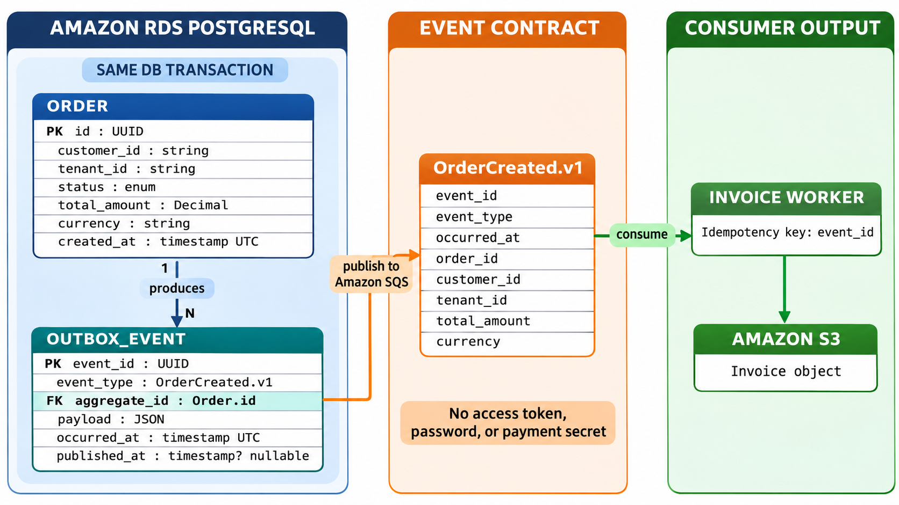
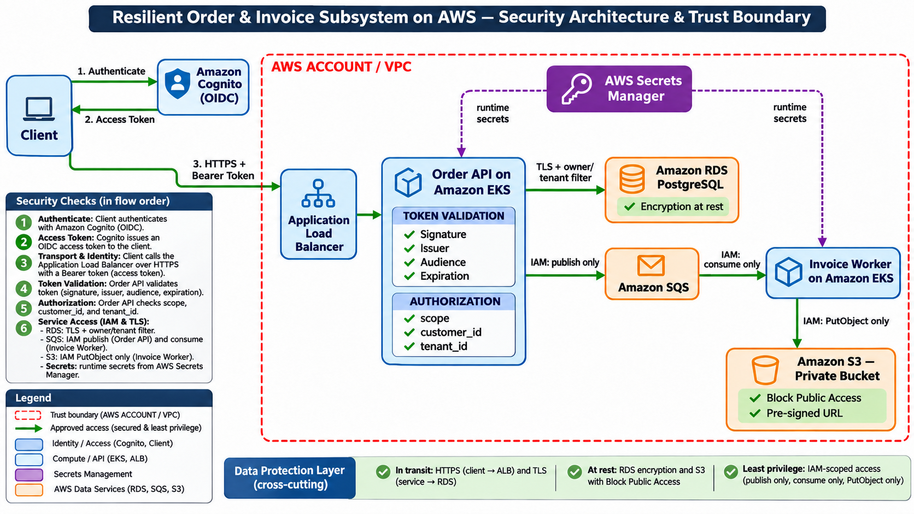
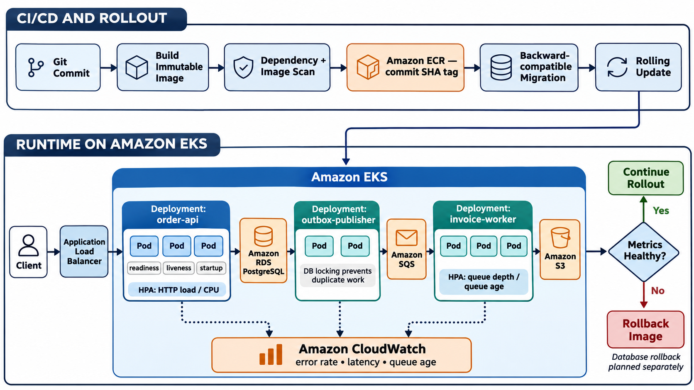
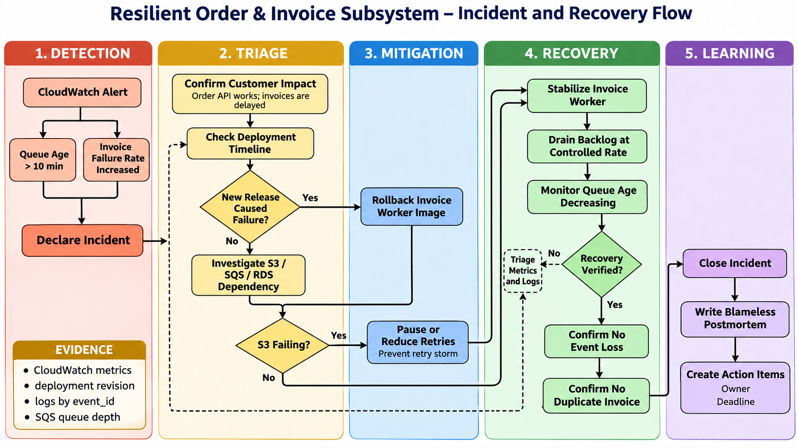

# Integrated Senior Project: Resilient Order & Invoice Subsystem

## 1. Executive summary

Project đề xuất xây dựng một subsystem giả lập chịu trách nhiệm tiếp nhận đơn hàng và tạo hóa đơn điện tử. Hệ thống cung cấp API để tạo và xem đơn hàng, lưu dữ liệu giao dịch, phát sự kiện sau khi đơn hàng được tạo và xử lý việc tạo hóa đơn ở background.

Tên project: **Resilient Order & Invoice Subsystem**  
Loại project: backend subsystem giả lập  
Ngôn ngữ và framework đề xuất: Python, Django và Django REST Framework  
Nền tảng đề xuất: Kubernetes trên AWS, Amazon RDS và Amazon S3

## 2. Problem statement

Một hệ thống bán hàng cần đáp ứng các yêu cầu sau:

- Client đã đăng nhập có thể tạo đơn hàng và xem đơn hàng thuộc về mình.
- Việc tạo đơn hàng phải nhanh; client không cần chờ file hóa đơn được tạo xong.
- Mỗi đơn hàng thành công phải dẫn đến đúng một hóa đơn logic, kể cả khi message bị giao lặp.
- Nếu worker tạo hóa đơn gặp lỗi tạm thời, công việc được thử lại mà không làm mất đơn hàng.
- Dữ liệu đơn hàng không bị mất khi Pod bị thay thế.
- File hóa đơn chỉ được truy cập bởi người có quyền.
- Nhóm vận hành có thể phát hiện tỷ lệ lỗi hoặc latency vượt mục tiêu.

## 3. Scope

### In scope

- API `POST /api/v1/orders` để tạo đơn hàng.
- API `GET /api/v1/orders/{id}` để xem đơn hàng.
- Lưu Order và Outbox Event trong cùng database transaction.
- Outbox Publisher gửi sự kiện `OrderCreated` đến message queue.
- Invoice Worker nhận sự kiện, tạo hóa đơn và lưu file vào S3.
- Xác thực bằng token OIDC và kiểm tra quyền sở hữu đơn hàng.
- Container hóa, deploy lên Kubernetes và cấu hình health probe.
- Metric, SLO, dashboard và quy tắc cảnh báo cơ bản.


### Out of scope

- Giao diện frontend.
- Thanh toán thật và tích hợp ngân hàng.
- Quản lý kho hoàn chỉnh.
- Multi-region active-active.
- Hệ thống kế toán hoặc thuế production.

## 4. Proposed architecture



*Figure 1 — AWS mapping: Amazon Cognito for OIDC, ALB for ingress, Amazon EKS for Kubernetes workloads, Amazon RDS for PostgreSQL, Amazon SQS for messaging, Amazon S3 for invoice storage, AWS Secrets Manager for secrets and Amazon CloudWatch for observability.*

Core components:

- **Order API:** nhận request, xác thực dữ liệu và thực thi use case tạo hoặc xem đơn hàng.
- **Amazon RDS PostgreSQL:** lưu Order, OrderItem, trạng thái hóa đơn và Outbox Event.
- **Outbox Publisher:** đọc các event chưa phát hành và gửi đến queue với lượng công việc đồng thời có giới hạn.
- **Invoice Worker:** xử lý `OrderCreated`, chống tạo trùng hóa đơn và ghi file vào S3.
- **Kubernetes:** chạy Order API, Outbox Publisher và Invoice Worker dưới dạng các Deployment riêng.
- **Observability stack:** thu thập metric phục vụ dashboard, SLO và alert.

## 5. Core workflows



*Figure 2 — End-to-end flow từ synchronous Create Order transaction, qua asynchronous Outbox publishing, đến idempotent Invoice generation.*

### 5.1 Create Order flow

1. Client gửi `POST /api/v1/orders` cùng OIDC access token.
2. API xác thực token, lấy `subject` và tenant từ claim đã tin cậy.
3. `CreateOrderUseCase` kiểm tra dữ liệu và tạo Order Aggregate.
4. Order và Outbox Event `OrderCreated` được lưu trong cùng transaction.
5. API trả `201 Created` cùng `order_id`; việc tạo hóa đơn diễn ra bất đồng bộ.

### 5.2 Event publishing flow

1. Outbox Publisher đọc một batch event chưa phát hành.
2. Publisher gửi event đến queue với số task đồng thời bị giới hạn.
3. Khi broker xác nhận thành công, publisher đánh dấu event đã phát hành.
4. Nếu gửi thất bại, event vẫn còn trong outbox để thử lại.

### 5.3 Invoice generation flow

1. Invoice Worker nhận `OrderCreated`.
2. Worker kiểm tra `event_id` đã được xử lý hay chưa.
3. Nếu chưa xử lý, worker tạo hóa đơn, lưu object vào S3 và ghi trạng thái hoàn tất.
4. Nếu cùng event được giao lại, worker trả kết quả thành công mà không tạo thêm hóa đơn logic.

## 6. Data model and minimum contracts



*Figure 3 — Order and OutboxEvent are committed in the same RDS transaction; `OrderCreated.v1` is published through Amazon SQS and consumed idempotently before the invoice object is stored in Amazon S3.*

### Order

- `id`: UUID.
- `customer_id`: subject của người tạo.
- `tenant_id`: phạm vi tổ chức.
- `status`: `CREATED`, `INVOICE_PENDING`, `INVOICED` hoặc `FAILED`.
- `total_amount`: Decimal và currency.
- `created_at`: timestamp UTC.

### Outbox Event

- `event_id`: UUID duy nhất.
- `event_type`: `OrderCreated`.
- `aggregate_id`: Order ID.
- `payload`: dữ liệu tối thiểu cần cho consumer.
- `occurred_at`: timestamp UTC.
- `published_at`: null cho đến khi phát hành thành công.

### Event contract `OrderCreated.v1`

```json
{
  "event_id": "uuid",
  "event_type": "OrderCreated.v1",
  "occurred_at": "2026-11-07T10:00:00Z",
  "order_id": "uuid",
  "customer_id": "user-123",
  "tenant_id": "tenant-7",
  "total_amount": "125.50",
  "currency": "USD"
}
```

Contract không chứa access token, password hoặc thông tin thanh toán nhạy cảm. Trường mới chỉ được thêm theo hướng tương thích ngược; thay đổi phá vỡ contract phải tạo version mới.

## 7. Security design



*Figure 4 — OIDC authentication, token validation, owner/tenant authorization, least-privilege IAM, runtime secrets and data-protection controls.*

### Authentication và authorization

> **Note — IdP của project:** Project sử dụng **Amazon Cognito** làm Identity Provider (IdP). Cognito chịu trách nhiệm đăng nhập, quản lý danh tính người dùng và phát hành OIDC token; Order API không tự xử lý username/password.

- Amazon Cognito thực hiện đăng nhập; Order API chỉ xác minh access token có issuer, audience, signature và expiration hợp lệ.
- API không chỉ kiểm tra người dùng đã đăng nhập mà luôn lọc Order theo `customer_id` và `tenant_id`.
- Endpoint quản trị dùng scope riêng, không dựa vào một cờ do client tự gửi.

### Secrets and data protection

- Secret không nằm trong Dockerfile, source code, manifest công khai hoặc log.
- Kubernetes workload nhận secret thông qua cơ chế tích hợp secret manager.
- RDS mã hóa at rest và kết nối dùng TLS.
- S3 bucket chặn public access; file được tải qua pre-signed URL thời hạn ngắn.

### Prioritized threats

| Threat | Kiểm soát đề xuất |
|---|---|
| User A đọc Order của User B | Lọc theo owner và tenant tại repository/use case; có test truy cập chéo. |
| Event giả được đưa vào queue | IAM giới hạn producer; consumer kiểm tra schema và trường bắt buộc. |
| Tạo nhiều hóa đơn do message lặp | Unique constraint theo `event_id` và idempotent consumer. |
| Lộ credential qua source hoặc log | Secret manager, redaction và secret scanning trong CI. |

## 8. Deployment and operations



*Figure 5 — Immutable-image CI/CD, rolling update on Amazon EKS, independent Deployments, probes, autoscaling, CloudWatch telemetry and rollback decision.*

### Main deployment concepts

**Backward-compatible migration** thay đổi database theo cách cả application version cũ và mới đều sử dụng được. Điều này cần thiết vì trong rolling update, Pod cũ và Pod mới cùng chạy trong một khoảng thời gian.

Ví dụ, release mới cần thêm `invoice_s3_key` cho Order:

1. Migration thêm column mới ở trạng thái nullable, chưa xóa hoặc đổi tên column cũ.
2. Version mới được deploy và bắt đầu ghi `invoice_s3_key`; version cũ vẫn hoạt động vì schema cũ chưa bị phá vỡ.
3. Nhóm backfill dữ liệu cũ và xác nhận mọi Pod đã chạy version mới.
4. Constraint `NOT NULL` hoặc việc xóa column cũ được thực hiện trong release sau.

Cách làm này thường được gọi là **expand–migrate–contract**. Không nên đổi tên hoặc xóa ngay một column mà Pod cũ vẫn cần, vì Pod đó có thể lỗi trong lúc rollout hoặc khi phải rollback.

**Rolling update** thay Pod cũ bằng Pod mới theo từng bước thay vì dừng toàn bộ service. Kubernetes tạo một số Pod dùng image mới, chờ startup/readiness probe thành công rồi mới giảm số Pod cũ. Trong project này, cách deploy đó giúp Order API tiếp tục nhận request trong khi release diễn ra. Nếu Pod mới không đạt readiness, nó không được ALB gửi traffic và rollout không nên tiếp tục loại bỏ Pod cũ.

**Rollback image** đưa Deployment về image/revision application ổn định trước đó, ví dụ từ `order-api:<commit-new>` về `order-api:<commit-old>`. Rollback được dùng khi release mới làm tăng 5xx, latency, queue age, memory usage hoặc tạo ra lỗi nghiệp vụ. Mục tiêu là giảm customer impact nhanh trước khi điều tra và sửa root cause.

Rollback image chỉ thay application code và Pod template; nó không tự đảo ngược database migration, dữ liệu đã ghi, message đã publish hoặc invoice đã tạo trên S3. Vì vậy migration phải backward-compatible và các side effect phải idempotent để version cũ có thể hoạt động an toàn sau rollback.

Ba workload được deploy độc lập:

- `order-api`: nhiều replica, có readiness và liveness probe.
- `outbox-publisher`: số replica nhỏ; dùng locking an toàn để tránh publish xung đột.
- `invoice-worker`: scale theo queue depth hoặc queue age.

Proposed rollout process:

1. Build immutable image và gắn tag theo commit SHA.
2. Scan dependency và image trước khi deploy.
3. Chạy migration tương thích ngược.
4. Rolling update với readiness probe.
5. Theo dõi error rate, latency và queue age.
6. Rollback image nếu chỉ số vượt ngưỡng; database migration cần kế hoạch rollback riêng.

## 9. SLI, SLO and alerting

Các mục tiêu ban đầu cho môi trường giả lập:

- **Availability SLI:** tỷ lệ request hợp lệ không trả 5xx.
- **Availability SLO:** 99,9% trong 30 ngày.
- **Latency SLI:** thời gian phản hồi của API tạo và xem đơn hàng.
- **Latency SLO:** 95% request hoàn tất dưới 300 ms.
- **Processing SLI:** thời gian từ khi Order được tạo đến khi hóa đơn hoàn tất.
- **Processing SLO:** 99% hóa đơn hoàn tất trong 5 phút.

Alert chính:

- Tỷ lệ 5xx vượt 5% trong 10 phút và có đủ traffic tối thiểu.
- p95 latency vượt 300 ms kéo dài 15 phút.
- Tuổi của message cũ nhất vượt 5 phút.
- Tỷ lệ tạo hóa đơn thất bại tăng liên tục.

Mỗi alert phải có service, environment, dashboard, runbook và người chịu trách nhiệm.

## 10. Incident and recovery scenario



*Figure 6 — Incident lifecycle từ CloudWatch detection, triage và mitigation đến controlled recovery, verification và blameless postmortem.*

Tình huống giả lập: queue age vượt 10 phút và tỷ lệ invoice failure tăng sau một release mới.

### 10.1 Detect and confirm impact

CloudWatch tạo alert khi oldest message age vượt 10 phút hoặc invoice failure rate vượt ngưỡng. Incident lead trước tiên xác nhận đây là ảnh hưởng thật, không chỉ là metric lỗi:

- Gửi thử request tạo Order và xác nhận Order API vẫn trả response bình thường.
- Kiểm tra Order đã được lưu nhưng trạng thái invoice vẫn là `INVOICE_PENDING`.
- Xác định số customer, số Order và khoảng thời gian bị ảnh hưởng.
- Declare incident và ghi nhận thời điểm bắt đầu để mọi người dùng chung một timeline.

Kết luận ban đầu trong scenario này là luồng synchronous vẫn hoạt động, nhưng asynchronous invoice processing đang bị chậm.

### 10.2 Triage using evidence

Nhóm chưa rollback ngay mà thu thập evidence để khoanh vùng nguyên nhân:

- **Deployment timeline:** Invoice Worker version nào vừa được release và lỗi bắt đầu trước hay sau rollout.
- **CloudWatch metrics:** worker error rate, processing duration, CPU/memory, SQS queue depth và queue age.
- **Application logs:** tìm theo `event_id` để biết worker fail ở bước đọc message, tạo invoice hay upload S3.
- **Dependencies:** kiểm tra error/throttling từ S3, SQS và RDS.

Nếu lỗi bắt đầu ngay sau release và chủ yếu xuất hiện ở revision mới, release là nghi phạm chính. Nếu nhiều workload cùng lỗi khi gọi một AWS service, nhóm ưu tiên điều tra dependency.

### 10.3 Mitigate the faulty release

Nếu revision mới gây lỗi, nhóm rollback riêng Invoice Worker về immutable image đã ổn định trước đó. Kubernetes tạo lại các worker Pod bằng image cũ và chỉ đưa chúng vào xử lý khi startup/readiness check thành công.

Rollback là mitigation để giảm ảnh hưởng nhanh, không phải root-cause fix. Order API không cần rollback nếu vẫn hoạt động bình thường. Message chưa xử lý vẫn nằm trong SQS nên worker cũ có thể tiếp tục xử lý sau khi ổn định.

Nếu evidence cho thấy release không phải nguyên nhân, nhóm không rollback theo cảm tính mà chuyển sang xử lý dependency hoặc cấu hình đang lỗi.

### 10.4 Control retries and dependency pressure

Nếu S3 đang throttling hoặc unavailable, retry liên tục từ nhiều worker có thể tạo retry storm và làm dependency khó phục hồi hơn. Nhóm thực hiện một hoặc nhiều biện pháp:

- Giảm worker concurrency hoặc tạm pause consumer.
- Dùng exponential backoff và jitter giữa các lần retry.
- Giới hạn số lần retry; message chưa xử lý được vẫn được giữ an toàn trong queue hoặc chuyển DLQ theo policy.
- Theo dõi S3 error rate trước khi tăng lại lưu lượng.

Mục tiêu là bảo vệ dependency và tránh biến một lỗi tạm thời thành sự cố lớn hơn; không xóa message chỉ để làm queue depth giảm.

### 10.5 Recover and drain backlog safely

Khi worker và dependencies đã ổn định, nhóm mở lại processing theo từng bước thay vì tăng toàn bộ capacity ngay lập tức:

1. Chạy một lượng worker nhỏ và xác nhận invoice mới được tạo thành công.
2. Tăng replica hoặc concurrency dần nếu RDS, SQS và S3 vẫn khỏe.
3. Theo dõi queue depth, oldest message age, processing rate và failure rate.
4. Duy trì tốc độ xử lý lớn hơn tốc độ message mới đi vào để backlog giảm đều.

Recovery được xem là tiến triển tốt khi queue age liên tục giảm, không có error spike mới và request của Order API vẫn đáp ứng SLO.

### 10.6 Verify data integrity

Queue trở về 0 chưa đủ để kết luận sự cố đã kết thúc. Nhóm cần reconcile dữ liệu giữa các thành phần:

- Mỗi Order cần invoice phải có Outbox Event tương ứng.
- Event đã acknowledge phải có processed record theo `event_id`.
- Order có trạng thái `INVOICED` phải tham chiếu đến invoice object tồn tại trong S3.
- Unique constraint và idempotency check phải bảo đảm cùng một `event_id` không tạo hai invoice logic.

Nhóm kiểm tra toàn bộ record trong khoảng incident hoặc ít nhất chạy reconciliation job cùng một số sample thủ công. Chỉ chuyển sang resolved khi không có event mất, duplicate invoice hoặc Order bị kẹt không rõ nguyên nhân.

### 10.7 Close incident and write postmortem

Incident được đóng sau khi metrics ổn định trong một khoảng theo dõi và customer impact đã kết thúc. Postmortem ghi lại:

- Impact và timeline từ alert đến recovery.
- Root cause và các contributing factors, ví dụ thiếu load test hoặc retry policy quá mạnh.
- Điều gì đã hoạt động tốt và điều gì làm recovery chậm.
- Corrective actions có **owner**, **deadline** và cách xác nhận hoàn thành.

Postmortem theo hướng blameless: tập trung cải thiện code, test, alert, runbook và deployment process thay vì tìm một cá nhân để đổ lỗi.

## 11. Topic 1–9 mapping

Phần này tổng hợp cách project sử dụng một hoặc hai nội dung trọng tâm từ mỗi topic. Mapping chỉ ra component áp dụng, hành vi mong muốn và cách có thể kiểm chứng khi project được triển khai.

### 11.1 Topic 1 — Advanced Python Concurrency

**Selected content:** `asyncio` và backpressure.

- **Áp dụng:** Outbox Publisher thực hiện các thao tác I/O như đọc batch event từ RDS và gửi `OrderCreated` đến Amazon SQS. Publisher có thể dùng `asyncio` để chờ nhiều network operation mà không cần tạo một OS thread cho mỗi event.
- **Kiểm soát tải:** số publish task đồng thời được giới hạn bằng `asyncio.Semaphore`; batch size và bounded queue ngăn publisher đọc vô hạn event vào memory. Khi SQS chậm, producer phải chờ thay vì tiếp tục tạo task không giới hạn.
- **Cách kiểm chứng:** load test với backlog lớn phải cho thấy số in-flight task không vượt cấu hình và memory không tăng liên tục.

### 11.2 Topic 2 — Clean Architecture for Django

**Selected content:** use cases và repositories.

- **Áp dụng:** Django view chỉ chuyển request thành input model rồi gọi `CreateOrderUseCase`. Use case điều phối việc tạo Order, lưu dữ liệu và ghi Outbox Event; nó không biết HTTP response hoặc chi tiết Django ORM.
- **Boundary:** use case phụ thuộc vào `OrderRepository` và `UnitOfWork` interface. `DjangoOrderRepository` là adapter dùng ORM để triển khai các interface này.
- **Cách kiểm chứng:** unit test có thể chạy `CreateOrderUseCase` với in-memory repository, không cần web server hoặc PostgreSQL thật.

### 11.3 Topic 3 — Domain-Driven Design

**Selected content:** Aggregate và domain event.

- **Áp dụng:** `Order` là Aggregate Root. Mọi thay đổi OrderItem, total amount và status phải đi qua các method của Order thay vì sửa trực tiếp từ view hoặc worker.
- **Business rules:** Aggregate từ chối đơn hàng không có item, quantity không hợp lệ hoặc total amount âm. Sau khi Order hợp lệ được tạo, Aggregate sinh domain event `OrderCreated`.
- **Cách kiểm chứng:** domain unit tests xác nhận invariant được giữ và `OrderCreated` chỉ xuất hiện sau một thao tác tạo Order hợp lệ.

### 11.4 Topic 4 — Microservices and API Integration

**Selected content:** API/event contracts và resilience.

- **Áp dụng contract:** HTTP API dùng version `/api/v1`; event dùng `event_type=OrderCreated.v1`. Producer và consumer có schema test để bảo đảm các field bắt buộc như `event_id`, `order_id` và `tenant_id` không bị xóa hoặc đổi kiểu ngoài kế hoạch.
- **Áp dụng resilience:** lời gọi AWS service có timeout. Retry chỉ dành cho lỗi tạm thời, sử dụng exponential backoff và giới hạn số lần thử; validation error hoặc authorization error không được retry.
- **Cách kiểm chứng:** contract test chạy trong CI; integration test mô phỏng SQS/S3 timeout để xác nhận request hoặc worker không chờ vô hạn.

### 11.5 Topic 5 — Event-Driven and Distributed Processing

**Selected content:** Transactional Outbox và idempotency.

- **Transactional Outbox:** Order và `OUTBOX_EVENT` được ghi trong cùng RDS transaction. Nếu transaction rollback, cả hai cùng không tồn tại; nếu commit thành công, event vẫn còn để publisher gửi lại dù process bị crash ngay sau đó.
- **Idempotency:** Invoice Worker lưu `event_id` đã xử lý với unique constraint. Khi SQS giao lại cùng message, worker nhận ra event cũ, không tạo invoice thứ hai và vẫn acknowledge message an toàn.
- **Cách kiểm chứng:** integration test crash publisher sau khi gửi và giao cùng event hai lần; kết quả cuối cùng phải chỉ có một invoice logic.

### 11.6 Topic 6 — AWS Cloud-Native Development

**Selected content:** Amazon RDS và Amazon S3.

- **Amazon RDS for PostgreSQL:** lưu Order và Outbox Event vì dữ liệu này cần transaction, foreign key, unique constraint và khả năng query nhất quán.
- **Amazon S3:** lưu invoice PDF vì đây là immutable object, không phù hợp để lưu trực tiếp trong Pod hoặc database row. Bucket chặn public access; client tải file bằng pre-signed URL có thời hạn ngắn.
- **Cách kiểm chứng:** database restore test xác nhận dữ liệu giao dịch; security test xác nhận object không thể truy cập công khai và URL hết hạn đúng cấu hình.

### 11.7 Topic 7 — Containers and Kubernetes Fundamentals

**Selected content:** Deployments và probes.

- **Deployments:** `order-api`, `outbox-publisher` và `invoice-worker` là ba Deployment độc lập trên Amazon EKS. API scale theo HTTP load, còn worker có thể scale theo SQS queue depth hoặc queue age.
- **Probes:** Order API chỉ được đưa vào ALB target khi readiness probe thành công. Liveness probe restart process bị treo; startup probe cho application đủ thời gian khởi động trước khi liveness được áp dụng.
- **Cách kiểm chứng:** rollout test tạo một Pod không đạt readiness và xác nhận Pod đó không nhận production traffic.

### 11.8 Topic 8 — Security Engineering

**Selected content:** OAuth 2.0/OIDC và secret management.

- **OIDC:** Amazon Cognito thực hiện login và phát token. Order API xác minh signature, `issuer`, `audience` và `exp`, sau đó dùng `sub`, `tenant_id` và `scope` để authentication và authorization. Query đọc Order luôn lọc theo owner và tenant.
- **Secret management:** RDS credential và application secret được lưu trong AWS Secrets Manager, cấp cho workload qua IAM role; secret không nằm trong image, Git repository hoặc application log.
- **Cách kiểm chứng:** security tests thử token hết hạn, sai audience và truy cập chéo tenant; secret scanning kiểm tra repository và container build context.

### 11.9 Topic 9 — Performance, Observability, and Reliability

**Selected content:** metrics và SLI/SLO.

- **Metrics:** Order API phát request count, 5xx rate và latency histogram. Publisher/worker phát outbox backlog, SQS queue age, processed count và invoice failure rate lên Amazon CloudWatch.
- **SLI/SLO:** API availability đặt mục tiêu 99,9%; p95 latency dưới 300 ms; 99% invoice hoàn tất trong 5 phút. Alert dựa trên mức ảnh hưởng đến các SLI này thay vì chỉ dựa vào CPU.
- **Cách kiểm chứng:** dashboard phải liên kết được HTTP request với backlog xử lý; game-day test làm chậm worker phải kích hoạt queue-age alert và thể hiện invoice-processing SLO suy giảm.
